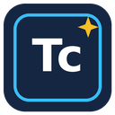
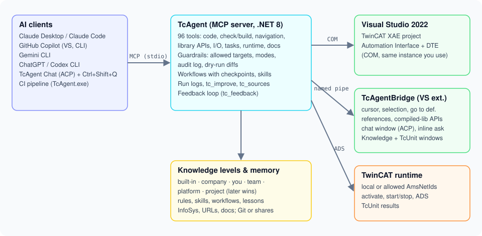

<p align="center"></p>

<h1 align="center">TcAgent – TwinCAT 3 for AI coding agents</h1>

<p align="center">
Let Claude, GitHub Copilot, Gemini or ChatGPT/Codex work <b>inside your running TwinCAT 3 IDE</b>:<br>
read and write PLC code, check and build, navigate, look up library APIs, configure I/O and tasks, control the runtime.
</p>

<p align="center">


</p>

<p align="center">
<a href="docs/img/tcagent-demo.mp4"></a><br>
<sub><b>▶ Click for the video in full quality</b> – one prompt: device manual → I/O → driver FB → TcUnit tests → HMI.<br>
<i>The video is a generated visualization to illustrate the workflow more clearly – in practice TcAgent works exactly like this.</i></sub>
</p>

---

## What the agent can do

| Area | What it means for you | Tools |
|---|---|---|
| **Your context** | The agent knows the object, line and selection you are working on – ask "what does *this* do?" | `tc_editor_context` |
| **PLC code** | Read, change (optionally as a diff to approve), create POUs, methods, properties, DUTs, GVLs; implement interfaces in one step | `tc_plc_read`, `tc_plc_write`, `tc_plc_create` |
| **Plain-text ST** | The whole PLC code as `.st` files (one per POU with its methods/properties/actions) for reviews, Git diffs and bulk edits – and back into the project, Ids kept, nothing deleted; also as CI gate | `tc_plaintext` |
| **SFC step chains** | Read and write sequential function charts as text – steps, actions, transitions, alternative and parallel branches, jumps; renumber steps, step comments, SFC flags | `tc_sfc` |
| **Lessons learned** | The agent remembers hard-won solutions – what the problem was, why, and how it was solved – and recalls them by itself when the same error comes up again (project, personal or team file) | `tc_lessons` |
| **Program documentation** | Explains the project: call hierarchy, call graph, inheritance hierarchy, class diagram, step chains (SFC and CASE), a short description for every FB, method and function (from comments or derived from the code), findings – one HTML page with zoomable diagrams, explanations kept as project memory; task overview with cycle times and a static risk analysis | `tc_doc` |
| **User manual** | Manual of FBs, functions and their structs/enums – in the style of your own example documents (Markdown, AsciiDoc or HTML), missing comments explained from the code | `tc_userdoc` |
| **Refactoring** | Meaningful names and comments for what you marked or clicked – every change confirmed by you (Apply / Apply all / Reject) | `tc_refactor` |
| **Navigation** | Go to definition and find references (read/write) – resolved like TwinCAT itself, across inheritance; opens the object in the editor at the right line | `tc_goto_definition`, `tc_editor_open`, `tc_find_references`, `tc_plc_search` |
| **Library APIs** | Full interfaces of referenced libraries – also compiled libraries – so the agent never invents an API | `tc_lib_signatures`, `tc_plc_references` |
| **Check & build** | "Check all objects" without generating code; real build before activation; compiler vs. runtime messages separated | `tc_check`, `tc_build`, `tc_errors` |
| **Tests** | TcUnit tests read from the code and run like in the Test Explorer: window **TcUnit Tests** (also in the XAE Shell) with run all / selected / failed, live progress and red/green per test; the same run for agents and on the command line; evaluate TcUnit results | `tc_test_run`, `tc_test_results` |
| **I/O & system** | Scan EtherCAT and assign adapters, add masters, couplers and terminals offline, link variables in bulk (structs to PDO groups element by element), tasks and PLC task assignment, boot project, config/run mode, licenses (read) | `tc_io_scan`, `tc_io_add`, `tc_link`, `tc_task`, `tc_runtime_mode` |
| **Projects & files** | New solutions and PLC projects, PLCopen/XTI export and import, libraries (references, placeholders, repositories, save as library), mapping export/import, archive, TwinCAT version, target platform, variants | `tc_new_solution`, `tc_plc_project_add`, `tc_export`, `tc_import`, `tc_library`, `tc_library_save` |
| **Library supply chain** | SBOM of the PLC project as CycloneDX 1.6 (libraries with version, vendor, purl, SHA-256, git commit) and a library lock file whose check fails the pipeline when a library version changes | `tc_sbom`, `tc_library_lock` |
| **Quality** | Static analysis (TE1200) with SARIF export | `tc_static_analysis` |
| **Network** | ADS broadcast search, add routes, TcCOM module instances | `tc_route_search`, `tc_route_add`, `tc_tccom` |
| **System** | Real-time cores and base time, task core assignment, CoE startup lists of EtherCAT devices, TwinCAT Package Manager (installed/available/outdated packages, install and upgrade with confirmation) | `tc_realtime`, `tc_coe`, `tc_packages`, `tc_packages_change` |
| **IDE dialogs** | Modal IDE dialogs are detected and reported instead of blocking silently | `tc_dialogs` |
| **Scope** | Scope configurations (TE130x): charts, axes, channels on PLC variables, record, export CSV/SVDX – also from the pipeline | `tc_scope_new`, `tc_scope` |
| **HMI** | TwinCAT HMI (TE2000) pages and regions, controls with PLC bindings and button actions, symbol mapping, build – directly in the project files | `tc_hmi`, `tc_hmi_page`, `tc_hmi_control`, `tc_hmi_symbol` |
| **Motion** | NC tasks and axes, link an axis to its drive | `tc_motion`, `tc_motion_add` |
| **TwinSAFE** | Safety projects, groups, alias devices, connections, CRCs – read only, writing is intentionally not supported | `tc_safety` |
| **Runtime** | Activate, login/start/stop, read/write variables via ADS – changes only on allowed targets | `tc_activate`, `tc_plc_online`, `ads_read`, `ads_write` |
| **Your rules** | Coding rules per project/person/company; "remember that I want X" becomes a rule | `tc_coding_rules`, `tc_coding_rules_add` |
| **Your risk checks** | Extend the risk analysis with your own rules (regex, tested on the project first), tune or switch off the built-in ones, add checks the agent reviews by reading the code – per project/person/company | `tc_risk_rules` |
| **Documentation** | Beckhoff InfoSys, your URLs, document folders and network shares – read-only | `tc_docs`, `tc_docs_add` |

All 89 tools with parameters: [docs/TOOLS.md](docs/TOOLS.md).

What you can do, explained step by step with example prompts: [docs/USER_GUIDE.md](docs/USER_GUIDE.md).

## In your CI pipeline

The same `TcAgent.exe` runs without an AI on a build server – check, build and TcUnit tests with exit code, JUnit XML
and annotations in the pull request:

```powershell
TcAgent.exe check --solution MyMachine.sln --junit results\check.xml
TcAgent.exe test  --solution MyMachine.sln --junit results\tests.xml
```

Or describe the pipeline once in the repository (`.tcagent\pipeline.json`: doctor, check, build, doc, sil, ...) and let
every CI system – and your PC – run it with one command:

```powershell
TcAgent.exe ci --init     # starter file with the solution found in the repository
TcAgent.exe ci            # runs the steps, each with a fresh IDE; summary in results\ci-summary.md
```

`TcAgent.exe st export|check|import` keeps a plain-text copy of the PLC code (`.st` files) next to the project –
readable diffs in pull requests, `st check` as gate, `references.json` with the library references of each PLC project;
no IDE needed: [docs/PLAINTEXT.md](docs/PLAINTEXT.md).

Ready-made definitions for GitHub Actions, Azure DevOps, Jenkins and GitLab: [docs/PIPELINE.md](docs/PIPELINE.md).
A GitHub runner on your PC, a VM or a Beckhoff IPC is set up with one script (`setup-runner.ps1`); `TcAgent.exe doctor`
tells you whether a machine is ready and what is missing – step by step in [docs/RUNNER_SETUP.md](docs/RUNNER_SETUP.md).

## Install

**Requirements:** Windows 10/11, Visual Studio 2022 with TwinCAT 3.1 XAE (tested with build 4026) and a
**TE1030** license (TwinCAT 3 Documentation Generation).

1. Download `TcAgent-<version>.vsix` from the [releases](https://github.com/ThorstenBrach/TcAgent/releases), close Visual Studio, double-click the file.
2. Start Visual Studio 2022 with your TwinCAT solution. TcAgent asks once whether it should register itself in the
   AI clients it finds (Claude Desktop/Code, GitHub Copilot in VS and CLI, Gemini CLI, Codex CLI). A backup of every
   changed config file is made.
3. Ask your agent: *"Connect to TwinCAT and show me the PLC project tree."* – or press **Ctrl+Shift+Q** in the code.

No scripts, no administrator rights, no .NET installation needed. Details, client sign-in and troubleshooting:
[docs/INSTALLATION.md](docs/INSTALLATION.md). Building from source: [Build](#build-from-source).

**TwinCAT XAE Shell:** TcAgent controls the shell just like Visual Studio. For the chat window and the inline question in the
shell run `vsbridge\install-xaeshell.ps1` once (shell closed, asks for administrator rights).

What changed in each version: [CHANGELOG.md](CHANGELOG.md).

## Use it where you work

**Inline question** – in the TwinCAT editor press **Ctrl+Shift+Q**, type, press Enter. You stay in the code; the answer
streams into the chat window. **TcAgent Chat** – a tool window with backend selection (Claude Code, Copilot CLI,
Gemini CLI, Codex CLI); the editor context is sent along automatically. Your prompts on the right, the agent's answers on
the left, ↑/↓ brings back earlier prompts, and documents (manuals, data sheets, screenshots, long texts) can be pasted or
dropped into the input box for the agent to use. **Any MCP client** – Claude Desktop, Copilot agent mode in Visual Studio,
or a CLI in your terminal use the very same tools.

| Client | How it is connected |
|---|---|
| Claude Desktop | `claude_desktop_config.json` |
| Claude Code | `claude mcp add tcagent` (user scope) + skill |
| GitHub Copilot in Visual Studio 17.14+ | `%USERPROFILE%\.mcp.json` – choose **Agent** mode, enable the tcagent tools |
| GitHub Copilot CLI | `~\.copilot\mcp-config.json` |
| Gemini CLI | `~\.gemini\settings.json` |
| ChatGPT / OpenAI Codex CLI | `~\.codex\config.toml` |

The ChatGPT desktop app only connects to MCP servers by URL. TcAgent deliberately stays local (stdio): a tool that
changes PLC code and starts and stops controllers does not belong on the network.

## How it works

<p align="center"></p>

* **TcAgent** (`src/`) – MCP server (.NET 8). Drives the IDE through the TwinCAT Automation Interface and the runtime through ADS.
* **TcAgentBridge** (`vsbridge/`) – Visual Studio extension inside the IDE process. Provides what is not reachable from
  outside: cursor and selection, name resolution and cross references, library interfaces,
  the chat window and the inline question. Without it all other tools still work.
* **Agent guide** (`agents/TCAGENT_GUIDE.md`, `SKILL.md`) – how an agent works safely with TcAgent; distributed as
  `AGENTS.md`, `GEMINI.md`, `CLAUDE.md`, `copilot-instructions.md` and as a Claude skill.

## Safety and guardrails

TcAgent can activate configurations, start and stop PLCs and write variables. The guardrails live in the server and
apply to **every** client:

| Setting (MCP config `env`) | Effect |
|---|---|
| `TCAGENT_ALLOW_TARGETS` | AmsNetIds allowed for activation, online commands, ADS writes. Default `local` = this PC only |
| `TCAGENT_MODE` | `agent` (default), `propose` (code changes only as a diff; reading, check and build still work, no other changes), `ask` (read-only) |
| `TCAGENT_CONFIRM` | `runtime` (default): you confirm every activation, PLC start/stop, ADS write, runtime mode change, route and package change – a Yes/No dialog in Visual Studio for the TcAgent Chat, the client's own question dialog elsewhere; if nobody can be asked, the action is refused · `all`: also project changes · `off`: never ask (pipelines - a deliberate setting) |
| `TCAGENT_SOLUTION` | optional, part of the solution path to pin one Visual Studio instance. Not needed normally: the chat always uses its own IDE, a single open solution is found automatically, with several the user picks from a list |
| `TCAGENT_AUDIT` | audit log of every changing call (default `%LOCALAPPDATA%\TcAgent\audit.jsonl`) |
| `TCAGENT_RULES` | additional coding rules (files/folders, `;`-separated); `TCAGENT_RULES_GATE=0` disables the one-time gate |
| `TCAGENT_RISK_RULES` | additional risk rules for `tc_doc action=risks` (files/folders, `;`-separated) |
| `TCAGENT_KNOWLEDGE` | additional knowledge sources (URLs/folders, `;`-separated) |
| `TCAGENT_SEARCH` | search service for `tc_docs` (`searxng:<url>` or `google:<key>:<id>`) |

**Never allow targets with real machines without agreement.** Safety projects (TwinSAFE) are never downloaded or
activated by the agent. See [SECURITY.md](SECURITY.md).

## Your files: rules, lessons, memory

Everything TcAgent learns about your project and your way of working lives in plain Markdown/JSON files – on three levels,
so the company standard, your personal style and the project's conventions (in Git) work together:

<p align="center"></p>

## Coding rules

Put your conventions in Markdown – TcAgent shows them to every agent before it writes code, whatever the client:

| File | Applies to |
|---|---|
| `<solution>\.tcagent\coding-rules.md` (and `coding-rules\*.md`) | the project – shared via Git |
| `%LOCALAPPDATA%\TcAgent\coding-rules.md` (and `coding-rules\*.md`) | you personally |
| `TCAGENT_RULES` | e.g. company rules on a network share |

Say *"remember: step sequences always as CASE over an enum"* and the agent adds it as a rule (`tc_coding_rules_add`).
Template: [docs/coding-rules.example.md](docs/coding-rules.example.md).

## Risk rules

The static risk analysis (`tc_doc action=risks`, the HTML documentation, `TcAgent.exe doc --risks --fail-on high` in the
pipeline) works the same way: `<solution>\.tcagent\risk-rules.md` (project, in Git), `%LOCALAPPDATA%\TcAgent\risk-rules.md`
(personal) and `TCAGENT_RISK_RULES` (company). In one Markdown file you can

- switch off a built-in rule, change its severity or its thresholds (`- long-code: limit=200`),
- add your own text rules (`## Rule memcpy-without-sizeof` with `find`/`require`, `unless`, `kinds`, `objects`, `severity`, `message`),
- list checks a regex cannot decide (`## Checks`) – the agent verifies them by reading the code.

Say *"check from now on that every MEMCPY uses SIZEOF"*: the agent tests the rule on your project (`tc_risk_rules action=test`),
shows the findings and saves it after your OK (`action=add`). Template: [docs/risk-rules.example.md](docs/risk-rules.example.md).

## Documentation and knowledge sources

The agent looks things up instead of guessing (`tc_docs`, read-only): Beckhoff InfoSys is built in; add URLs, document
folders and network shares per project (`<solution>\.tcagent\knowledge.md`, `.tcagent\knowledge\`) or personally
(`%LOCALAPPDATA%\TcAgent\`). PDF, Word, HTML, Markdown, text, XML, CSV, JSON and ST files are indexed; extracted text is cached.

## Feedback loop

Agents report problems, missing features and unclear descriptions through `tc_feedback` (with version, client, machine and
solution) – into a local file or a shared team folder (`TCAGENT_FEEDBACK`). `tc_feedback action=list|summary|resolve` and
`TcAgent.exe feedback --open --markdown feedback.md` turn them into a triage list for GitHub issues. That is where the next
improvements come from – see [CONTRIBUTING.md](CONTRIBUTING.md).

## Build from source

```powershell
git clone https://github.com/ThorstenBrach/TcAgent.git
cd TcAgent

# developer build (TcAgent + extension), then install the extension as administrator
powershell -ExecutionPolicy Bypass -File .\build.ps1
powershell -ExecutionPolicy Bypass -File .\vsbridge\build.ps1
powershell -ExecutionPolicy Bypass -File .\vsbridge\install.ps1

# or the installable package bin\TcAgent-<version>.vsix
powershell -ExecutionPolicy Bypass -File .\build-vsix.ps1

# unit tests (no TwinCAT needed)
dotnet test tests\TcAgent.Tests
```

Requirements: Windows 10/11, Visual Studio 2022 with TwinCAT 3.1 XAE (tested with 4026), TE1030 license, .NET 8 SDK.
The Automation Interface interop is generated from your local TwinCAT installation and is never redistributed.

```
src/                    TcAgent (MCP server, .NET 8)
vsbridge/               TcAgentBridge (VS 2022 extension, .NET Framework): chat window, inline ask, installer;
                        install-xaeshell.ps1 builds and installs it for the TwinCAT XAE Shell
agents/TCAGENT_GUIDE.md agent guide (source for AGENTS.md / GEMINI.md / CLAUDE.md / copilot-instructions.md)
SKILL.md                the same guide as a Claude skill
setup-clients.ps1       registers TcAgent in all AI clients (run automatically by the VSIX)
setup-runner.ps1        sets up a GitHub Actions self-hosted runner for TwinCAT pipelines
build.ps1, build-vsix.ps1, test.ps1
tests/TcAgent.Tests/     unit tests of the file logic (xUnit, no TwinCAT): dotnet test tests\TcAgent.Tests
docs/                   installation, tool reference, CI pipelines (docs/pipeline/), images
```

## Roadmap

* SIL/HIL: first version available (`TcAgent.exe sil` / `hil`, see [docs/PIPELINE.md](docs/PIPELINE.md)) – simulated I/O next
* Motion: axis parameters (drive links are available)
* TwinSAFE: analyze and propose on top of the read-only view – never download

## Known limitations

* Windows with Visual Studio 2022 or the TwinCAT XAE Shell (the XAE Shell is less tested).
* Scope and HMI changes are written to the project files while the project is unloaded in the IDE and reloaded afterwards –
  unsaved changes in their open editors are saved first. Scope needs matching Scope packages for the IDE (see troubleshooting).
* Every Automation Interface call runs on the IDE's UI thread – while the agent works, the IDE can pause briefly.
* Tested with TwinCAT 3.1 build 4026; other builds may need adjustments.

## Legal

TcAgent is an independent open-source project and is not affiliated with Beckhoff Automation, Microsoft,
Anthropic, GitHub, Google or OpenAI. TwinCAT is a registered trademark of Beckhoff Automation GmbH & Co. KG; all other
trademarks belong to their owners. The source code of TcAgent contains no code from Beckhoff.
Check the license terms of your TwinCAT installation for your use case. Third-party components and their licenses:
[THIRD-PARTY-NOTICES.md](THIRD-PARTY-NOTICES.md). Use at your own risk, see [LICENSE](LICENSE).

## License

[MIT](LICENSE) © 2026 Thorsten Brach
