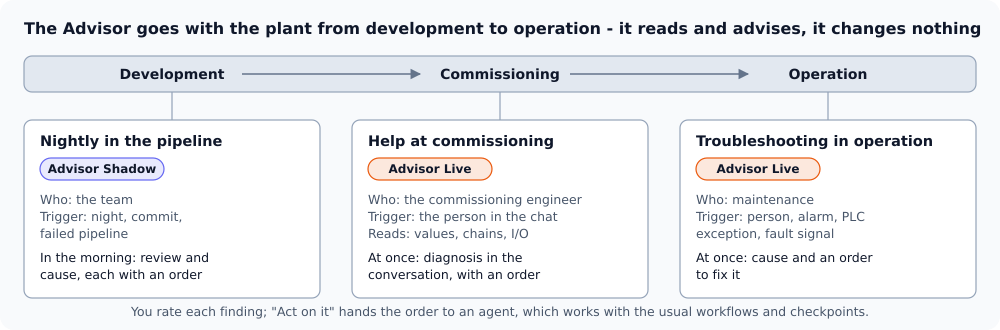
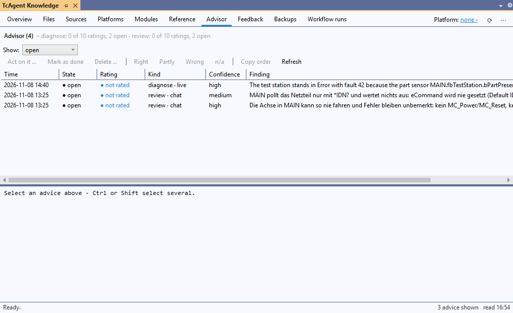

# Advisor

The Advisor is an agent that looks, advises and hands over a ready order – it changes nothing itself. A person reads the
advice, rates it, and sends the order to an agent when it should be acted on. That agent then works as usual, with
workflows, checkpoints and confirmations.

<p align="center"></p>

| | Advisor Shadow | Advisor Live |
|---|---|---|
| When | in the background: at night, after a commit, after a failed pipeline | at the running plant: commissioning, troubleshooting in operation |
| Who | the team | the person in front of the machine |
| Reads | code, commits and diff, errors, test results | in addition online values, alarms, step chains |
| Started by | `TcAgent.exe advise`, or `/advise` in the chat | the person (`/advise-live` in the chat), or the watch (`TcAgent.exe advise watch --run`) |
| State | available | available |

## What an Advisor run may do

A run is read only, and TcAgent enforces it – not the prompt:

- `tc_advisor action=start` makes the session read only until `action=finish`: every tool that would change the project or
  the runtime is refused, the audit log records each call.
- `TcAgent.exe advise` starts the AI client with its own MCP configuration: TcAgent with `TCAGENT_MODE=ask` and
  `TCAGENT_ADVISOR` set.
- A code change is only proposed, as a diff in the advice. It is never applied.

## The advice

Each finding is recorded with `tc_advisor action=record` and has the same fields:

| Field | Content |
|---|---|
| finding | one sentence: what was found |
| evidence | quotes from tool outputs with their place (object, line, variable, value) |
| proposal | what should be done, optionally a diff |
| order | a self-contained prompt a person sends to an agent to act on it, naming the workflow (`bug-fix`, `new-feature`, …) |
| confidence | high, medium or low, with one sentence why |

The advice is kept in the project, in Git for the whole team: `<solution folder>\.tcagent\advisor\<yyyy-MM>.jsonl`, one
line per advice. A rating is a line of its own (append only), so two people never edit the same line.

## Rating and hit rate

Everyone who works on the project can rate an advice: right, partly, wrong or n/a; the name is stored with it. The hit
rate per kind of task (review, diagnose, cause) is "right" among the last 20 rated; under 10 ratings there is no rate.
Advice that stays unrated for 14 days no longer counts as open.

## Where you see it

<p align="center"></p>

- **Knowledge window, tab Advisor:** the advice with its evidence, order and diff; one click to rate it; **Act on it …**
  opens the TcAgent Chat with the order in the input – you read it, change it and send it. The advice is then marked
  "sent", and the agent marks it done when the work is proven (`tc_advisor action=done`) – or you do (**Mark as done**).
  **Delete …** removes an advice from the list; it stays in the Git history. Ctrl or Shift select several: rating, **Mark as
  done**, **Delete …** and **Act on it …** apply to all of them (one order with all findings in the chat).
- `TcAgent.exe advise list|stats --solution <sln> [--open] [--json]`, `tc_advisor action=list|stats`. `advise rate`, `acted`,
  `done` and `delete` take several ids at once (`--id AD-1,AD-2`).

## Starting a run

**In the chat:** the prompt `/advise` – choose the kind (review, diagnose, cause) and what to look at. `/review-prj` reviews a
whole project with the workflow `project-review` and records its findings as advice too.

**Without a window** (pipeline, scheduled task):

```powershell
TcAgent.exe advise --solution MyMachine.sln --trigger nightly                      # review of the commits of the last 24 hours
TcAgent.exe advise --solution MyMachine.sln --trigger pipeline --results results   # cause of a failed pipeline
TcAgent.exe advise --solution MyMachine.sln --trigger project                      # the whole project (workflow project-review), e.g. monthly
```

- The context is collected without an AI: the commits and the diff since `--since` (default "24 hours ago"), the result
  files of the pipeline (`--results`). Nothing committed: no run, no tokens.
- The AI client is the one chosen in the chat. For now only **Claude Code** runs without a window; it must be signed in
  for the user the runner runs as.
- A run stops after `--minutes` (default 15). An IDE the run opened without a window is closed afterwards – never one that
  was open before.
- `--dry-run` prints the prompt only.

In a pipeline: [PIPELINE.md](PIPELINE.md#advisor).

## Advisor Live

At the running plant the Advisor helps the person in front of it: commissioning, troubleshooting in operation. It only reads:
it never writes a variable and never starts, stops or acknowledges anything.

**Same code?** Before it reads code, the Advisor compares what runs with the project: the project name and the time of the build
on the PLC (`_AppInfo.ProjectName`, `AppTimestamp`) with the last build of the project and its source files, and unsaved
changes in the IDE. If they may differ, it says so and concludes only from values - not from code that may not run.

**In the chat:** `/advise-live` with what is wrong. The agent first looks at the state of the plant (`tc_advisor action=watch_check`),
then goes from the top level down only as far as it needs, and records the cause with an order.

**The watch:** `TcAgent.exe advise watch --solution <sln> --target <AmsNetId>` looks every 2 s and reports what newly went
wrong, the same event at most once an hour. With `--run` it starts an Advisor run for it (`--max-runs n` ends the watch after n runs); `--once` looks once (exit 1 when
something is wrong).

What it notices, without any setup:

1. the runtime or a PLC leaving Run (Stop, Error, Exception), a task exceeding its cycle time
2. the person, in the chat

And what the project declares, in `.tcagent\advisor-watch.json` (edited by hand, or in the chat: "remember: `nFault` other
than 0 is a fault" - `tc_advisor action=watch_add` after you agreed):

```json
{
  "signals": [
    { "symbol": "MAIN.fbStation.bError", "when": "true", "text": "Station reports a fault" },
    { "symbol": "MAIN.fbStation.nFault", "when": "!= 0", "text": "Fault number", "details": ["MAIN.fbStation.nStep"] },
    { "symbol": "MAIN.fbStation.nState", "when": "& 128", "text": "Error bit of the state" },
    { "symbol": "MAIN.fbConveyor.nStep", "when": "unchanged 30s", "text": "Conveyor hangs in a step" }
  ]
}
```

`when`: `true`, `false`, `== n`, `!= n`, `> n`, `>= n`, `< n`, `<= n`, `& n` (a bit of the mask is set), `unchanged <n>s`.
`details` are read as well when the signal fires; `port` is the ADS port of the PLC (default 851).

A plugin brings what it knows about its platform: an `advisor.json` with the skill that knows how the platform reports
faults, and fixed signals if there are any ([PLUGINS.md](PLUGINS.md#fault-signals-for-the-advisor)). TcAgent itself knows no platform.
