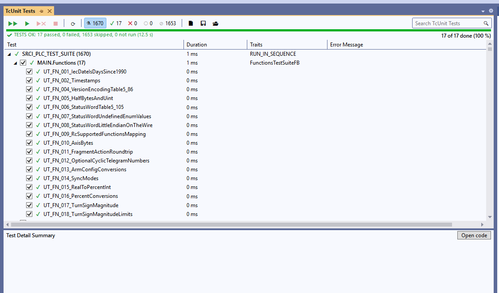
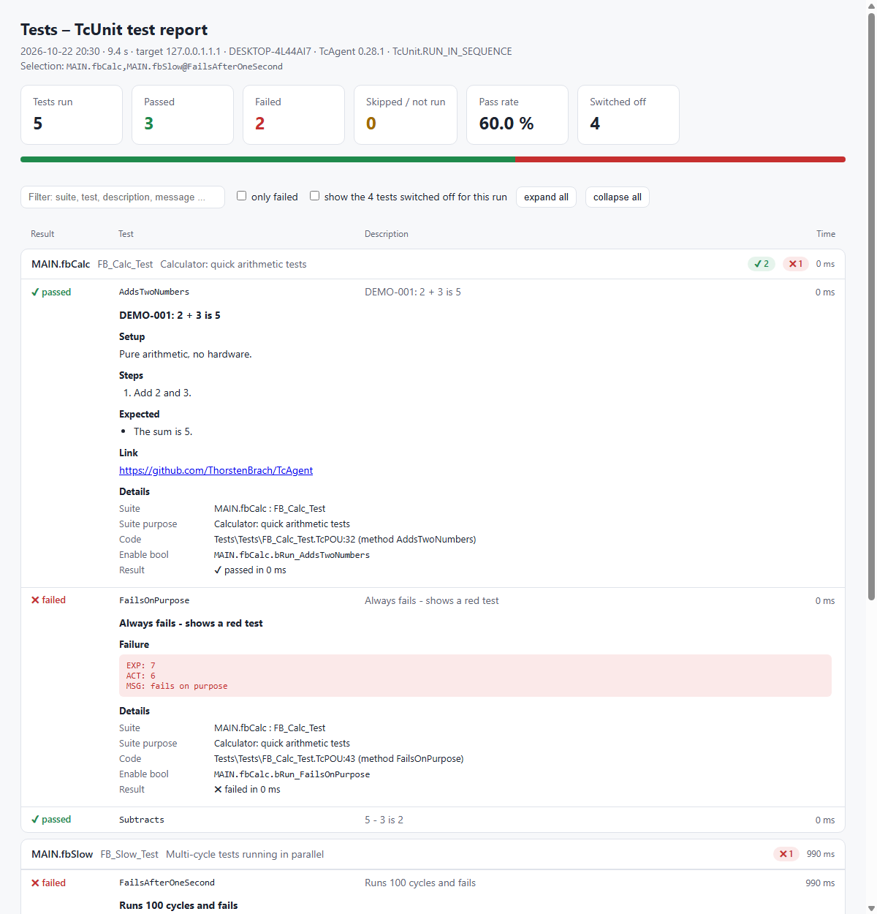

# TcUnit test window

The window **TcUnit Tests** shows the TcUnit tests of the open solution like the Test Explorer of Visual Studio:
the tests read from the code, run buttons, live progress, red/green results with the failure message, an HTML test
report – in Visual Studio 2022 and in the TwinCAT XAE Shell (which has no Test Explorer). The same run is available to
the AI agent (tool `tc_test_run`) and on the command line (`TcAgent.exe tcunit`).



*1670 tests of a real project; 17 of them ticked and run, the others switched off for this run.*

Contents: [Quick start](#1-quick-start) · [How it works](#2-how-it-works) · [Using the window](#3-using-the-window) ·
[Selectable tests: the enable bools](#4-selectable-tests-the-enable-bools) · [Describing tests](#5-describing-tests) ·
[What happens during a run](#6-what-happens-during-a-run) · [Configuration](#7-configuration) ·
[Test report](#8-test-report) · [Without the window](#9-without-the-window) · [Limits and troubleshooting](#10-limits-and-troubleshooting)

---

## 1. Quick start

1. Install the VS extension TcAgentBridge (double-click `TcAgent-<version>.vsix`, [INSTALLATION.md](INSTALLATION.md)).
2. Open the TwinCAT solution with your TcUnit tests and **View > Other Windows > TcUnit Tests** (or the **Tests**
   button of the TcAgent Chat). The window lists every suite instance and every test of the code.
3. Click **▶▶ Run All Tests**. The first run builds, activates the configuration on the local runtime and starts the
   PLC; later runs start within seconds as long as the code did not change.
4. Tick single tests or suites and click **▶ Run** – only those run. For this the suites need the enable bools of
   [section 4](#4-selectable-tests-the-enable-bools); without them a suite runs as a whole.
5. Click **📄** for the HTML test report of the last run.

## 2. How it works

```
 TcUnit Tests window (VS extension)            TcAgent.exe                         TwinCAT
 ──────────────────────────────────            ───────────                         ───────
 tree, buttons, progress, details   ── tcunit list ──>  reads .plcproj / .TcPOU files
                                    <── JSON (suites, tests, /// texts, bools)
 Run (ticked tests)                 ── tcunit run --tests ... ──>
                                                        save all, compare code ──> build + activate (only if changed)
                                                        reset PLC (ADS)        ──> all variables to initial values
                                                        write enable bools     ──> bRun_... := TRUE / FALSE
                                                        start PLC (ADS)        ──> TcUnit runs the switched-on tests
                                    <── one JSON event  read TcUnit's table    <── <suite>.Tests[i]: finished, failed, ...
                                        per line        (every 300 ms)
                                                        failure texts          <── runtime messages (EXP / ACT / MSG)
                                                        reset PLC again
 📄 Report                          ── tcunit report ─> HTML from the run (last.json) and the /// texts of the code
```

- **The tests come from the code.** TcAgent reads the project files: every function block that extends
  `TcUnit.FB_TestSuite` (also through other suites), every instance of it in a `PROGRAM` or GVL, every
  `TEST('…')` / `TEST_ORDERED('…')` with a literal name, the `///` comments and the enable bools. Nothing is
  registered or listed by hand; the list is read again after every build and when code files are saved.
- **TcUnit itself has no test filter.** The selection works with ordinary `BOOL` variables in the suites (`bRunSuite`,
  `bRun_<Test>`, all `TRUE` initially) around the test calls. Before a run TcAgent resets the PLC and writes them via
  ADS – `TRUE` for the selected tests, `FALSE` for the rest. Nobody writes them in a pipeline or after a normal
  activation, so there all tests run as before.
- **Live results** come from TcUnit's own table of each suite (`Tests[i]` with name, finished, failed, skipped,
  message, duration), not from parsing the log: a test turns red as soon as an assertion fails.
- **No IDE login:** start, stop, reset and the bools go via ADS; the IDE is only used to save, build and activate.
  That avoids the download and online-change questions of the IDE.

## 3. Using the window

The window is laid out like the Test Explorer: a tool bar, below it the progress bar, then the list with the columns
**Test**, **Duration**, **Traits** and **Error Message** (drag the column borders in the header to change their width)
and the **Test Detail Summary** at the bottom.

| Tool bar | What it does |
|---|---|
| ▶▶ **Run All Tests** | Runs every test of the PLC project. |
| ▶ **Run** | Runs the ticked suites/tests – or, if nothing is ticked, the selected line. The others are switched off for this run. |
| ▶✖ **Run Failed Tests** | Runs the tests that failed in the last run. |
| ■ **Cancel** | Stops the run: reset of the PLC; tests that have not finished stay "not run". |
| ⟳ **Refresh** | Reads the tests from the code again. |
| ⊞ **Expand all** / ⊟ **Collapse all** | Opens or closes all suites. |
| Status filter buttons ⚗ ✔ ✖ ○ ⊘ | Show the number of all / passed / failed / not run / skipped tests. A click shows only those (several can be combined); ⚗ shows all again. |
| 📄 **Test report** | HTML test report of the last run, opened in the browser ([section 8](#8-test-report)). |
| 💾 **Save** / 📂 **Load** | Saves the ticked suites and tests as a test selection `*.tcunit.json` (default folder `.tcagent` of the solution, can be versioned with the project) and ticks them again later. The same file works on the command line: `tcunit run --tests @file`. |
| Search box (right) | Narrows the list to tests whose name, suite or description contains the text. |

- **Ticking:** a ticked suite ticks all its tests; if only some tests of a suite are ticked, the suite box is partly
  filled and only those tests run. A greyed-out checkbox means the test has no enable bool – it can only run with its
  whole suite. Space ticks the selected line.
- **Opening the code:** double-click a test (or Enter, or **Open code**) opens its method in the TwinCAT editor at the
  `TEST(...)` line. Double-click on a suite opens/closes it.
- **Status symbols:** ○ not run, ◐ running, ✔ passed, ✖ failed, ⊘ skipped (switched off for this run, or skipped by TcUnit).
- **Traits:** of a suite its type, `No bRunSuite`, `Whole suite`; of a test `Ordered` (`TEST_ORDERED`), `No bRun_`, `Skipped`.
- **Details:** description and test case text ([section 5](#5-describing-tests)), status and duration, failure
  message (`EXP`, `ACT`, `MSG`), file and line, path of the enable bool.
- **Progress:** "Test 12 of 87: <name> – about 1:20 min left" on the left, "12 of 87 done (14 %)" on the right; before
  a run "17 of 1670 test(s) selected". Inside one suite TcUnit calls all `TEST()` tests in the same PLC cycles (only
  `TEST_ORDERED()` tests run one after the other), so the name shown is the test called last; the results per test are
  exact anyway. With `TcUnit.RUN()` (all suites at the same time) the bar shows only "n of N tests finished".

## 4. Selectable tests: the enable bools

The AI agent writes tests this way on its own (rule 8 of the TcAgent skill / agent guide); ask it *"make the tests of
FB_Motor_Test selectable"* for an existing suite. By hand:

### 4.1 The rules

| Bool | Where | Effect when `FALSE` |
|---|---|---|
| `bRunSuite : BOOL := TRUE;` | in the `VAR` of the suite (or of a base suite) | no test of this suite instance runs |
| `bRun_<TestMethod> : BOOL := TRUE;` | in the `VAR` of the suite, one per test | this test is not called |

- Exactly these names. For a test in its own method the bool is named after the **method**; for a test written
  directly in the suite body (or called from it with a literal name) after the **test name**.
- Initial value `TRUE`, never written in your code, not `RETAIN`/`PERSISTENT` – the reset before a run must set them
  back to `TRUE`.
- Only the test **calls** are inside the `IF`s; the suite body itself keeps running (TcUnit needs it).
- A switched-off test is simply never called: TcUnit does not know it, and a suite without any switched-on test
  finishes at once – it does not block the run.

### 4.2 One test per method (recommended)

```
/// Motor block: start, stop and fault handling
FUNCTION_BLOCK FB_Motor_Test EXTENDS TcUnit.FB_TestSuite
VAR
    bRunSuite                        : BOOL := TRUE;
    bRun_WhenStartedExpectRunning    : BOOL := TRUE;
    bRun_WhenStoppedExpectStandstill : BOOL := TRUE;
END_VAR

IF bRunSuite THEN
    IF bRun_WhenStartedExpectRunning THEN WhenStartedExpectRunning(); END_IF
    IF bRun_WhenStoppedExpectStandstill THEN WhenStoppedExpectStandstill(); END_IF
END_IF
```

```
/// The motor reports Running one cycle after Start
METHOD WhenStartedExpectRunning
TEST('WhenStartedExpectRunning');
...
TEST_FINISHED();
```

The name in `TEST('...')` is the method name, so a result maps to its method.

### 4.3 Tests written in the suite body

```
IF bRunSuite THEN
    IF bRun_DefaultsAreValid THEN
        TEST('DefaultsAreValid');
        AssertTrue(Condition := Settings.IsValid(), Message := 'defaults');
        TEST_FINISHED();
    END_IF
END_IF
```

### 4.4 One method, several tests (parameters)

A test method that runs with different parameters gets one call per test, each with a **literal** test name, and one
bool per test name:

```
VAR
    bRunSuite                       : BOOL := TRUE;
    bRun_SyncModes_ClientToServer   : BOOL := TRUE;
    bRun_SyncModes_ServerToClient   : BOOL := TRUE;
END_VAR

IF bRunSuite THEN
    IF bRun_SyncModes_ClientToServer THEN
        SyncModes( Active := TEST_ORDERED('SyncModes_ClientToServer'), Mode := 1 );
    END_IF
    IF bRun_SyncModes_ServerToClient THEN
        SyncModes( Active := TEST_ORDERED('SyncModes_ServerToClient'), Mode := 2 );
    END_IF
END_IF
```

```
/// Synchronization modes of the data sets
METHOD SyncModes
VAR_INPUT
    /// The test runs (result of TEST_ORDERED of the caller)
    Active : BOOL;
    Mode   : INT;
END_VAR
IF Active THEN
    ...
    TEST_FINISHED();
END_IF
```

Generated suites (one test per block, per enum value …) work the same way: the generator writes one `IF bRun_<name>`
with a literal name per test instead of a loop over `TEST(sName)`.

### 4.5 Base suites

`bRunSuite` (and helper methods) may be declared once in a common base suite
(`FUNCTION_BLOCK FB_MyTestSuite EXTENDS TcUnit.FB_TestSuite`); every suite derived from it has it.

### 4.6 Without the bools

Suites without the convention keep working everywhere: without `bRunSuite` the suite always runs, tests without
`bRun_…` run whenever their suite runs ("whole suite only" in the window, greyed-out checkbox). Test names that are
not a literal (`TEST(sName)`) are known only at run time: they appear in the window after the first run, and their
suite runs as a whole.

### 4.7 Check

`TcAgent.exe tcunit list --solution <sln>` (or the agent: `tc_test_run action=list`) lists every test with the path of
its enable bool, e.g. `MAIN.fbMotor.bRun_WhenStartedExpectRunning`; a test without one has `"enable": null` (in the
list of the agent: `[no bRun_…]`).

## 5. Describing tests

The `///` comments in the code are the descriptions of the window and of the report.

- **Suite instance:** a `///` comment above every instance in the test program, e.g.
  `/// UT-GPIB: GPIB commands and GpibSerialFB (without hardware)`.
- **Test:** a `///` comment above every test method – its first line (or sentence) is the description.
- **The whole test case:** below the first line the comment may hold the test case in sections. A line
  `Keyword: text` starts a section, `1.` and `-` lines are lists, links become clickable:

  ```
  /// UT-FN-001: IEC date is days since 1990
  /// Setup: Pure function test of the library conversion functions, no SDK.
  /// Steps:
  /// 1. Convert the dates 1990-01-01 and 2026-09-26 with DATE_TO_IEC_DATE.
  /// Expected:
  /// - 1990-01-01 gives 0.
  /// - 2026-09-26 gives 13417.
  /// Blocks: DATE_TO_IEC_DATE
  /// Link: https://example.com/cases/UT-FN-001
  METHOD UT_FN_001_IecDateIsDaysSince1990
  ```

  The first line (up to an empty `///` line or the first section) is the description; a sentence wrapped over several
  lines stays one description. Any keywords can be used; `reportGroupBy` ([section 7](#7-configuration)) groups the
  report by one of them (e.g. `Blocks`).
- **Tests called from the suite body** (4.3, 4.4) take the comment of the method they call. A `///` comment directly
  above the call adds to it, e.g. the block of this one test:

  ```
  IF bRun_GEN_04_MC_GroupResetFB THEN
      /// GEN-04 / MC_GroupResetFB: valid command, not executed
      /// Blocks: MC_GroupResetFB
      Run( Active := TEST_ORDERED('GEN_04_MC_GroupResetFB'), Idx := 27 );
  END_IF
  ```

- If the test cases live in a catalog of their own (a document, a YAML file), a small script can write them into the
  comments and check them in CI – e.g. `tools/case_docs.py` of the SRCI tests writes 443 catalog cases into the
  comments of 1677 tests.

## 6. What happens during a run

1. **Target:** the local runtime by default. A test PLC in the network only if `target` in `.tcagent\tcunit.json`
   names it and it is allowed in `TCAGENT_ALLOW_TARGETS` (for the window: a Windows environment variable of the
   user, Visual Studio passes it on); then the window asks once per run.
2. **Save all**, then TcAgent compares the code with what the runtime runs (the project files and the build time of
   the PLC program in the runtime).
3. **Only if it changed** (or TwinCAT is in Config mode, or the runtime runs another program): **build**, boot
   project, **activate** and restart TwinCAT in Run mode. TwinCAT stays in Run mode afterwards. Otherwise the run starts
   right away.
4. **Reset** of the PLC via ADS: the PLC stops, TcUnit starts from zero, all enable bools are `TRUE` again.
5. **Selection:** TcAgent writes *all* enable bools via ADS – `TRUE` for the selected tests, `FALSE` for the rest.
6. **Start** of the PLC via ADS; the window follows the progress.
7. **End:** after TcUnit has printed its results TcAgent takes the failure texts from the runtime messages, makes a
   **reset** again (so the next run can start right away) and keeps the results for the report.

Clicking a run button is the confirmation for the whole local run; there is no dialog per step. Every run is recorded
in the audit log (`tc_policy` shows where).

## 7. Configuration

Optional, in `<solution folder>\.tcagent\tcunit.json` (versioned in Git with the project):

```json
{
  "plcProject": "Tests",
  "target": "local",
  "timeout": "00:05:00",
  "progress": "GVL_Progress.Progress",
  "reportGroupBy": "Blocks"
}
```

| Key | Default | Meaning |
|---|---|---|
| `plcProject` | the only PLC project with TcUnit suites | PLC project the window runs (name or tree path `TIPC^Tests^Tests Project`) |
| `target` | `local` | `local` or the AmsNetId of a test PLC (must be in `TCAGENT_ALLOW_TARGETS`) |
| `timeout` | 5 minutes | maximum duration of a run (`"hh:mm:ss"` or seconds); then the PLC is reset and open tests stay "not run" |
| `progress` | empty | ADS path of a progress block, see below |
| `reportGroupBy` | empty | the report gets a second view that groups the tests by the values of this `///` section, e.g. `Blocks` for `/// Blocks: MC_GroupResetFB` (several values comma-separated) |
| `report` | TcAgent's own report | a command line of your own that makes the HTML report instead, run in the solution folder; `{junit}` = results of the last run (JUnit XML), `{html}` = file to write, also `{solution}`, `{solutionDir}` |

**Progress block (optional):** if the test project has a block like `TestProgressFB` (`GVL_Progress.Progress` with the
outputs `Total`, `Current`, `Done`, `Test`, `Remaining`, `Finished`), TcAgent reads it while the run goes and the
progress bar shows its values. Without it TcAgent takes the running test from TcUnit itself.

## 8. Test report

**📄** in the window (or `TcAgent.exe tcunit report --solution <sln>`) makes an HTML report of the last run and opens
it in the browser – one self-contained file to archive or send:



- Run information: time, duration, target, PC, git branch and commit (with a note on uncommitted changes), TcAgent
  version and the selection of the run.
- Cards: tests run, passed, failed, skipped / not run, pass rate and – separately – the tests switched off for this
  run (hidden in the list unless "show switched off" is ticked).
- Every suite instance with its purpose; every test with result, description and duration. Opened: the test case
  text of [section 5](#5-describing-tests), the failure text (`EXP` / `ACT` / `MSG`; failed tests are open from the
  start), code position, enable bool.
- With `reportGroupBy` a second view, e.g. by the function block under test: a test about several blocks is listed
  under each of them; switch between **Blocks** and **Suite** at the top.
- Search, "only failed", expand / collapse all; a summary table per suite (and per group); light and dark theme.

Good descriptions in the code make a good report – no separate report tool is needed. Every run keeps its results in
`%LOCALAPPDATA%\TcAgent\tcunit\<solution>-<hash>\` (`last.xml` JUnit, `last.json` the run), outside the repository.
For a report tool of your own set `report` in the configuration; `tcunit report --builtin` still makes TcAgent's own.
The command comes with the solution (a cloned repository, say), so it runs only after you approved it once for this
solution and exactly this command text: the window shows the command and asks; on the command line `tcunit report`
prints an id, `tcunit report --approve <id>` approves and runs it. Until then, and after the command changed, TcAgent's
own report is made. TcAgent's own report encodes every text of the code and the runtime, links only http(s) URLs and
allows no external resources (Content-Security-Policy).

## 9. Without the window

- `TcAgent.exe tcunit list --solution <sln> [--plc <name>]` – the tests from the code as JSON: projects, suites,
  instances, tests with file, line, description, test case text (`details`) and the paths of the enable bools. No IDE
  needed.
- `TcAgent.exe tcunit run --solution <sln> | --attach [pid] [--tests <a,b>] [--plc <name>] [--target local|<AmsNetId>]
  [--timeout <s>] [--junit <file>] [--no-build] [--download]` – the run of [section 6](#6-what-happens-during-a-run).
  `--tests` takes instances (`MAIN.fbMotor`), suite types (`FB_Motor_Test`), single tests
  (`MAIN.fbMotor@WhenStartedExpectRunning`, `FB_Motor_Test.WhenStartedExpectRunning` or just the test name) or
  `@<file>` – a test selection saved in the window (`*.tcunit.json`, relative to the solution folder) or a `*.txt` file
  with one entry per line (a selection never sets the target); default all. The output is one JSON event per line (`plan`, `step`, `suite`, `running`,
  `result`, `progress`, `done`); a line `cancel` on stdin (or Ctrl+C) stops the run. `--download` builds and activates
  even if the code did not change. Exit code 0 = all passed, 1 = failed tests or build errors, 2 = refused target or
  unknown test names, 3 = infrastructure problem or timeout.
- `TcAgent.exe tcunit report --solution <sln> [--junit <file>] [--out <file.html>] [--builtin] [--approve <id>]` – the report of
  [section 8](#8-test-report). No IDE needed.
- In the chat: *"Run only the tests of FB_Motor_Test"*, *"Which tests failed and why?"* (tool `tc_test_run`,
  `action=list` lists the tests).

Pipelines keep using `sil` / `hil` ([PIPELINE.md](PIPELINE.md)); there nobody switches tests off, so all tests run.
A saved selection can run in a pipeline with `tcunit run --solution <sln> --tests @.tcagent\smoke.tcunit.json --junit
results\tcunit.xml`.

## 10. Limits and troubleshooting

| Situation | Explanation / remedy |
|---|---|
| A test has a greyed-out checkbox | No `bRun_<Test>` bool: it runs with its whole suite ([4.1](#41-the-rules)). |
| A suite always runs | No `bRunSuite` bool in the suite (or its base suite). |
| Tests appear only after the first run | Their names are not literals (`TEST(sName)`); give each test a literal name ([4.4](#44-one-method-several-tests-parameters)). |
| A suite instance is missing | Instances are found in `PROGRAM`s and GVLs (also `ARRAY[..] OF`), not inside other function blocks. |
| "Writing … failed" at the start | The runtime runs an older program than the code – run once with download (`--download`) or build and activate. |
| Progress only "n of N finished" | `TcUnit.RUN()` runs all suites at the same time; `TcUnit.RUN_IN_SEQUENCE()` gives the test names. |
| A remote test PLC is refused | It must be in `TCAGENT_ALLOW_TARGETS` (user environment variable for the window, `--allow` is only for `hil`). |
| Report not created | No run yet, or the `report` command failed – the status line of the window shows its output. |

TcAgent reads TcUnit's internal tables (`GVL_TcUnit`, `<suite>.Tests[i]`); tested with TcUnit 1.3.2.
