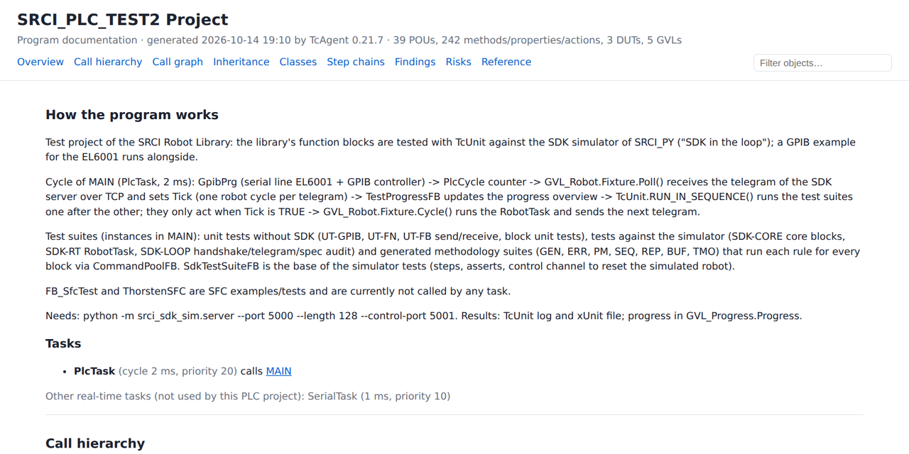
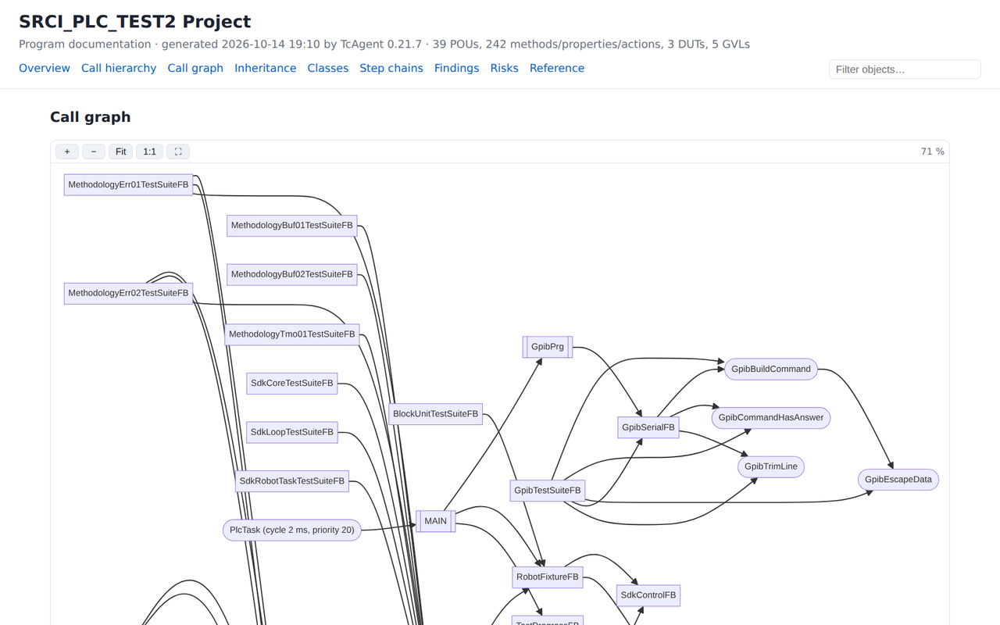
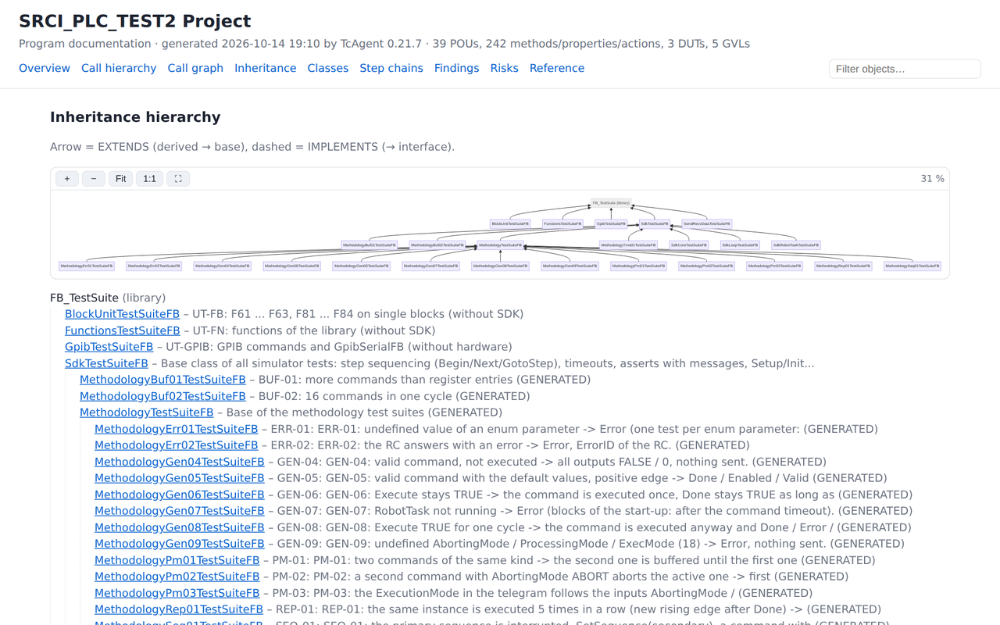
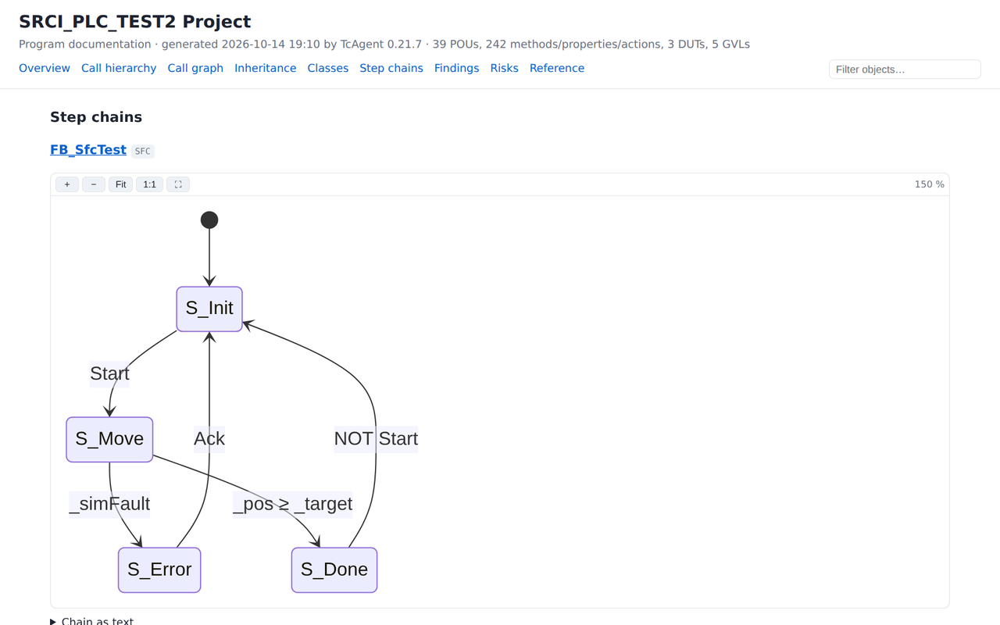
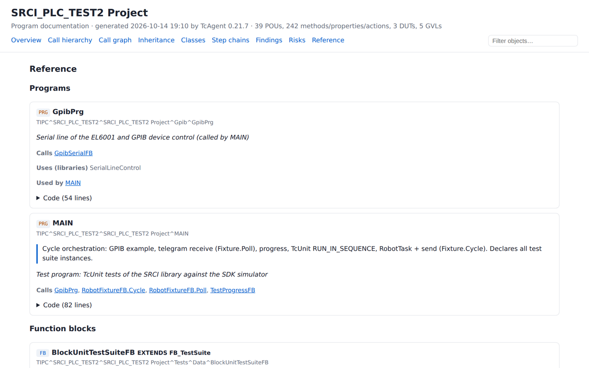
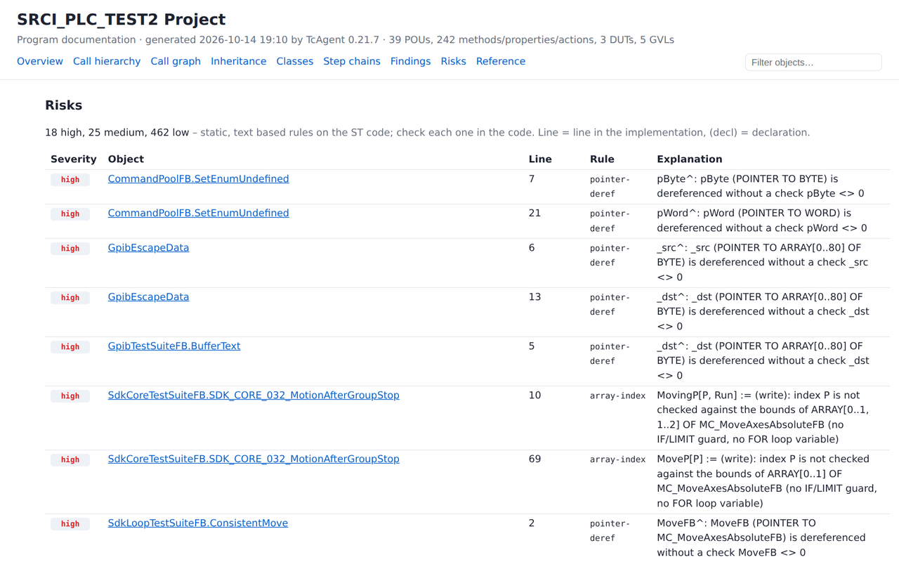
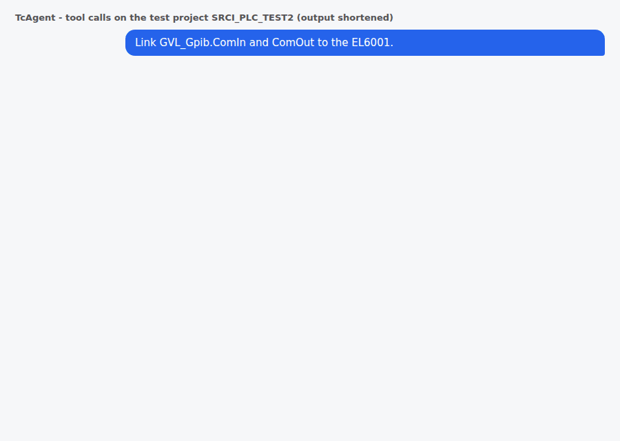
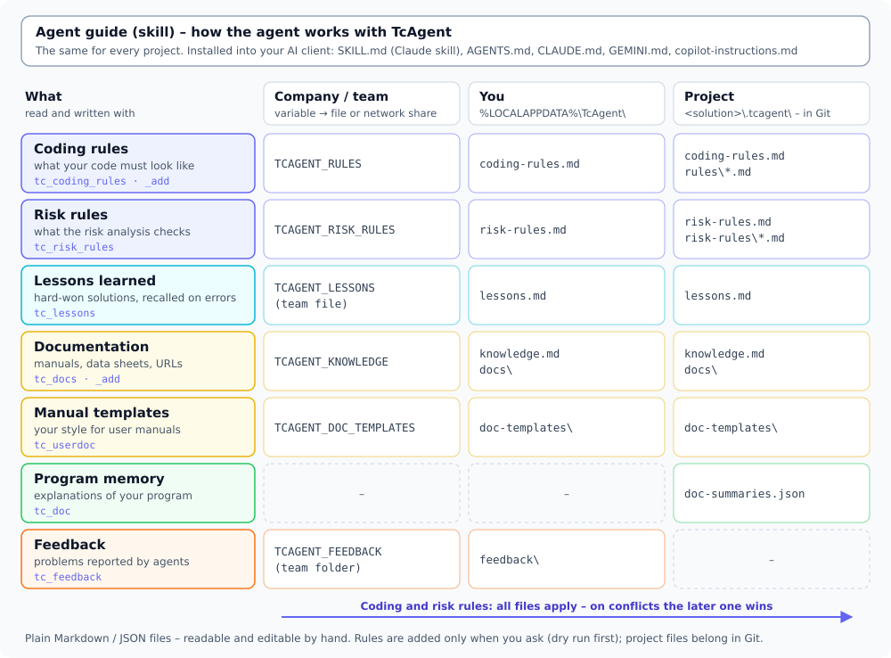

# TcAgent user guide

TcAgent lets an AI agent (Claude, GitHub Copilot, Gemini or ChatGPT/Codex) work **inside your running TwinCAT 3 IDE**.
You type what you want in plain language. The agent calls TcAgent's tools to read and write PLC code, check and build,
navigate, look up library APIs, configure I/O and tasks, and control the runtime.

This guide is written for PLC programmers and automation engineers. It explains, task by task, **what you can ask
for, how to ask, what the agent does, and where the limits and safeguards are**. For the exact parameters of every
tool see the [tool reference](TOOLS.md). Tool names appear in `backticks` throughout so you can look them up there.

There are three ways to use TcAgent:

| Way | Where | Good for |
|---|---|---|
| **TcAgent Chat** and the **inline question** (Ctrl+Shift+Q) | A tool window inside Visual Studio / TwinCAT XAE, provided by the VS extension TcAgentBridge | Everyday work in the code. The agent sees your editor context automatically. |
| **Any MCP client** | Claude Desktop, Claude Code, GitHub Copilot (agent mode in Visual Studio 17.14+ or the CLI), Gemini CLI, Codex CLI | The same tools from the client you already use. |
| **Command line (CLI)** | `TcAgent.exe check`, `test`, `sil`, `hil` and others on a build server | CI pipelines without an AI: exit codes, JUnit XML, annotations. |

<p align="center"><a href="img/tcagent-demo.mp4"></a><br><sub>Click for the video. It is a generated visualization of the workflow; in practice TcAgent works exactly like this.</sub></p>

Installation is covered in [INSTALLATION.md](INSTALLATION.md). This guide starts once TcAgent is installed and at
least one AI client is signed in.

---

## Contents

- [Getting started](#getting-started)
- [Understanding code](#understanding-code)
- [Writing and changing code](#writing-and-changing-code)
- [Plain-text ST files](#plain-text-st-files)
- [Coding rules](#coding-rules)
- [Library APIs](#library-apis)
- [SFC step chains](#sfc-step-chains)
- [Refactoring names and comments](#refactoring-names-and-comments)
- [Tests with TcUnit](#tests-with-tcunit)
- [Program documentation](#program-documentation)
- [Risk analysis and your own risk rules](#risk-analysis-and-your-own-risk-rules)
- [User manuals](#user-manuals)
- [I/O and EtherCAT](#io-and-ethercat)
- [Tasks, real-time cores, boot project and licenses](#tasks-real-time-cores-boot-project-and-licenses)
- [Motion](#motion)
- [Scope](#scope)
- [HMI](#hmi)
- [TwinSAFE (read only)](#twinsafe-read-only)
- [Runtime: activate, online, ADS](#runtime-activate-online-ads)
- [Projects, files, libraries and packages](#projects-files-libraries-and-packages)
- [Network: routes and TcCOM](#network-routes-and-tccom)
- [Knowledge: documentation and lessons learned](#knowledge-documentation-and-lessons-learned)
- [IDE dialogs](#ide-dialogs)
- [Feedback and audit](#feedback-and-audit)
- [CI pipeline](#ci-pipeline)
- [Safety and guardrails](#safety-and-guardrails)
- [Configuration reference](#configuration-reference)
- [Tips, troubleshooting and FAQ](#tips-troubleshooting-and-faq)
- [Tool index](#tool-index)

---

## Getting started

### Your first prompts

Open Visual Studio 2022 (or the TwinCAT XAE Shell) with your TwinCAT solution and wait until the PLC project has
loaded. Then try one of these, in the TcAgent Chat or in your MCP client:

- *"Connect to TwinCAT and show me the PLC project tree."*
- *"Connect to TwinCAT, show me the PLC project tree and build the project."*
- *"Which libraries does the PLC project reference, and in which versions?"*
- With the VS extension: open a method, click into a variable name and ask *"Where is this declared and where is it written?"*

The agent connects on the first tool call, lists the tree with `tc_tree` (`TIPC` = PLC, `TIID` = I/O, `TIRT` = tasks,
`TISC` = TwinSAFE if present) and answers. You do not have to name tools – describe the task.

### Connecting to the right solution

Normally you do not need to do anything:

- The **TcAgent Chat** always works with the IDE it runs in.
- If exactly one Visual Studio / XAE Shell instance has a solution open, the agent connects to it automatically.
- With **several** open TwinCAT solutions, the client shows a selection list (if it supports MCP elicitation);
  otherwise the agent shows you the list and asks which one. It never guesses.
- After an IDE restart, TcAgent reconnects to the same solution on the next call.

Related tools and prompts:

| You ask | The agent uses |
|---|---|
| *"Which TwinCAT solutions are open?"* | `tc_instances` |
| *"Connect to the solution MyMachine."* | `tc_attach solution=MyMachine` (or `pid=...`) |
| *"Open C:\Projects\MyMachine\MyMachine.sln."* | `tc_open` (starts Visual Studio or the XAE Shell) |
| *"Which solution and target are you connected to?"* | `tc_status` (connection, solution, target AmsNetId) |
| *"Which TcAgent version is running?"* | `tc_version` |

If you always want to pin one instance, set `TCAGENT_SOLUTION` (part of the solution path) in the client's MCP
configuration – see [Configuration reference](#configuration-reference).

### What the VS extension (TcAgentBridge) adds

TcAgent drives the IDE from outside through the TwinCAT Automation Interface. Code, build, tests, I/O and runtime all
work without the extension. The extension runs **inside** the IDE process and adds what is not reachable from outside:

- **TcAgent Chat** – a tool window with backend selection (Claude Code, Copilot CLI, Gemini CLI, Codex CLI). Your prompts
  on the right, the agent's answers on the left, tool calls as compact lines. Enter sends, Shift+Enter makes a new line,
  ↑/↓ brings back earlier prompts (kept across sessions). **New chat** clears the history, **Stop** cancels the running
  answer. The editor context is sent along automatically.
- **Documents in the chat** – paste (Ctrl+V), drop or attach (+) manuals, data sheets, screenshots and long texts. Text files
  and Word documents go into the prompt; PDFs and images are read by the agent from the attachments folder.
- **Inline question** – press **Ctrl+Shift+Q** in the TwinCAT editor, type, press Enter. You stay in the code; the answer
  streams into the chat window. Esc cancels. (The hotkey can be changed with `askHotkey` in
  `%LOCALAPPDATA%\TcAgent\chat-backends.json`.)
- **Cursor and selection** for `tc_editor_context`.
- **Go to definition and cross references** resolved like TwinCAT itself (`tc_goto_definition`, `tc_find_references`).
- **Library interfaces**, including compiled third-party libraries (`tc_lib_signatures`).
- **Cursor placement** when opening an object in the editor (`tc_editor_open`).
- **Confirmation dialogs** in Visual Studio for runtime actions and refactoring when you work from the TcAgent Chat.

The chat window opens when Visual Studio starts (unless `"showOnStartup": false` is set in `chat-backends.json`). The
agent can also open it with `tc_ide command=chat_show`. If you install an AI client later, click **Set up clients** in
the chat window.

To check that the extension is running, ask *"Is the TcAgent bridge running?"* – the agent calls `tc_ide command=ping`.
`tc_ide` also offers `context` (raw editor context), `libs` (libraries installed in the repository), `probe`
(diagnostics, writes `probe.txt`) and `lm_call` (advanced read-only diagnostics). You will rarely need these.

**TwinCAT XAE Shell:** TcAgent controls the shell like Visual Studio. For the chat window and the inline question in the
shell, run `vsbridge\install-xaeshell.ps1` once (shell closed, asks for administrator rights). After an update install the VSIX
of the same version too - the shell takes the new `TcAgent.exe` from it.

The chat window shows the TcAgent version at the top right. If it says *"TcAgent server x ≠ extension y"* in orange, the chat
still starts the old server: click **Set up clients**, then **New chat**. The backend you chose last (Claude, Copilot,
Gemini, Codex) is selected again the next time.

### How the agent works

Whatever you ask, a well-behaved agent follows the same order (the agent guide shipped with TcAgent tells it to):

1. **Context** – if you say "here", "this FB", "the selected lines": `tc_editor_context` first.
2. **Read before writing** – `tc_plc_read` on the object, follow its header comment and naming style.
3. **Coding rules** – `tc_coding_rules` once per session before the first write.
4. **Change** – `tc_plc_write` / `tc_plc_create` (or a diff for your approval).
5. **Check** – `tc_check` once after all changes, until 0 compiler errors.
6. **Save** – `tc_save`. Until then, changes exist only in the IDE, not on disk or in Git.

For pure questions (reading, searching, explaining) nothing is checked or built. If you say "don't check" or
"don't build", the agent does not.

### Orienting in the project tree

- *"Show me the PLC project tree three levels deep."* – `tc_tree path=TIPC depth=3`. The PLC project is the node with
  `type=600` (for example `TIPC^MyPlc^MyPlc Project`), the PLC instance has `type=57` (`...^MyPlc Instance`).
- *"Show me the I/O tree below Device 1."* – `tc_tree path="TIID^Device 1 (EtherCAT)"`.
- *"Show me the XML settings of the EL3102."* – `tc_xml_get` returns the XML description of any tree item
  (parameters, I/O configuration, task settings, online settings). `recursive=true` includes children.

Tree paths use `^` as separator. You can copy them from the agent's answers into later prompts.

---

## Understanding code

**Good for:** finding your way around unfamiliar code, explaining what a block does, tracing where a variable is
written, jumping to a definition.

### Example prompts

- *"What does this method do?"* (with the cursor in the method)
- *"Explain the selected lines."*
- *"Where is `_startTime` declared, and what type is it?"*
- *"Who writes `GVL_Machine.bAutoMode`?"*
- *"Find every call of `FB_Axis.MoveAbs` in the project."*
- *"Open `FB_Axis.Start` at implementation line 42."*
- *"Go to the definition of `MC_MoveAbsolute` (like F12)."*

### What the agent does

| Step | Tool | What you get |
|---|---|---|
| Find out what you mean by "this" | `tc_editor_context` | Active document, tree path, part (declaration/implementation), cursor line, selection and the selected text with a code excerpt |
| Read the object | `tc_plc_read` | Declaration and implementation, including child objects (methods, properties, actions) |
| Resolve a name | `tc_goto_definition` | For variables: type, declaration site and resolved type. For types/POUs: tree path in the project or the library |
| Find usages | `tc_find_references` | All usages with access kind (declaration / read / write), tree path and line – TwinCAT's cross references plus a whole-word text search as cross-check |
| Free text / regex search | `tc_plc_search` | Hits with tree path, part and line |
| Show you the place | `tc_editor_open` | Opens the object in the editor, cursor on the line |

### Details worth knowing

- **Editor context.** The first tree path is always the active document, resolved from its file path – two methods
  with the same name in different FBs are not mixed up. A selection that ends at column 1 of the next line counts as
  whole lines. Without the extension you get the active window and selected tree items, but no cursor or selection.
- **Go to definition** resolves names the way TwinCAT does, in the scope of the object open in the editor. Without a
  symbol it uses the word at the cursor (or the selection). It also accepts `GVL_Progress.Progress` or
  `instance.Input`. If no editor is active (for example the chat window has the focus), the last active editor is
  used; types are then resolved at project level in every PLC project including its libraries. Without an open editor,
  POUs, DUTs, GVLs and their members are looked up in the project tree – local variables then need an open editor or
  `tc_plc_search`. With `open=true` the definition is opened at the declaration line, like F12. Library objects cannot
  be opened.
- **Search** supports `regex`, `caseSensitive`, `part` (`decl`, `impl`, `all`), `path` (search only below a tree path;
  a single FB includes the FB itself and its methods/actions) and `max` (default 200).
- **Open in editor** changes nothing in the project, so it is allowed even in the read-only modes. Line numbers count
  per part, as in `tc_plc_read`. With the extension the cursor is set and verified; without it the object is opened
  but the cursor is usually not placed. Actions and transitions (no declaration part) get the cursor at their
  implementation line.
- SFC POUs are shown by `tc_plc_read` as chain text, not as the internal editor XML (see
  [SFC step chains](#sfc-step-chains)).

### Limits

- Cursor, selection, go to definition and cross references need the VS extension.
- If you have not clicked into the editor since Visual Studio started, the cursor is reported as "declaration, line 1".
  Click into the code once.

---

## Writing and changing code

**Good for:** new POUs, methods, properties, DUTs and GVLs, changes to existing code, implementing interfaces.

### Example prompts

- *"Create a function block FB_ConveyorControl with inputs bStart, bStop and an output bRunning."*
- *"Add a method Reset to FB_Axis that clears the error and sets the state to Idle."*
- *"Create FB_SerialDriver that implements I_Communication."*
- *"Create an enum E_ConveyorState with Idle, Running, Error."*
- *"Change MAIN so that it calls fbConveyor with the inputs from GVL_IO – show me the diff first."*
- *"Fix the compiler errors."*

### What the agent does

1. Reads the coding rules (`tc_coding_rules`) once per session – see [Coding rules](#coding-rules).
2. Reads the object it changes (`tc_plc_read`).
3. Writes:
   - `tc_plc_write` replaces the **complete** declaration and/or implementation part of an object.
   - `tc_plc_create` creates an object. `kind` is one of `folder`, `program`, `function`, `function_block`, `dut_enum`,
     `dut_struct`, `dut_union`, `dut_alias`, `gvl`, `interface`, `method`, `interface_method`, `property`,
     `interface_property`, `property_get`, `property_set`, `action`, `transition`. Language: ST (default), IL, SFC, FBD,
     CFC, LD. For methods, `parentPath` is the FB.
4. Checks with `tc_check` once after all changes and fixes errors until 0 compiler errors remain.
5. Saves with `tc_save`.

### Implementing an interface in one step

*"Create FB_Robot that implements I_Robot."* – `tc_plc_create kind=function_block implements=I_Robot` creates the FB with
`IMPLEMENTS` and **all** methods and properties of the interface (including inherited ones via `EXTENDS`, and Get/Set
accessors) as stubs in one call – for project and library interfaces. Several interfaces are comma-separated. The agent
then fills the stubs with `tc_plc_write`.

Properties created with `tc_plc_create` always get Get and Set accessors. `getImplementation` and `setImplementation`
set their code directly.

### Seeing the change before it is made

Add *"show me the diff first"* or *"don't change anything yet"*. The agent then calls `tc_plc_write` / `tc_plc_create`
with `dryRun=true` and shows you a diff (or what would be created). Nothing is written until you say so.

In **propose mode** (`TCAGENT_MODE=propose`) this is enforced: code changes always come back as a diff and every other
change is blocked. See [Safety and guardrails](#safety-and-guardrails).

### Check versus build

| | `tc_check` | `tc_build` |
|---|---|---|
| What it is | "Check all objects" | Real build of the solution |
| Finds errors in unused POUs | yes | no – unused POUs are not compiled (use `checkAll=true`) |
| Produces code and files | no | yes |
| When the agent uses it | after code changes – the default | before activation/download, for I/O linking (process image), or when you ask |

Results come with file and TwinCAT error code (`Cxxxx`). `tc_check` lists compiler messages only; messages without a
source position (imports, device descriptions) are shown separately and do not count. `tc_build` sums up the repeated
"device … already exists in file …" INFO messages in one line. `tc_build rebuild=true` cleans first.

`tc_errors` reads the IDE error list, split into compiler/project messages and PLC runtime/TcUnit messages
(`kind=compile|runtime|all`).

When a check or build reports errors, TcAgent appends matching [lessons learned](#knowledge-documentation-and-lessons-learned)
automatically.

### Saving

*"Save everything."* – `tc_save` saves all modified files of the solution (like Ctrl+Shift+S). Until then, tool changes
exist only in the IDE. A good agent saves at the end of a task; ask for it if you want to commit.

### Deleting objects

*"Delete the unused POU FB_Old."* – `tc_delete` removes a child item of the tree. **A backup is written first** to
`<solution>\.tcagent\backup\delete` (PLC objects as PLCopen XML, other items as ProduceXml; the folder is git-ignored).
To restore: *"Restore FB_Old from the delete backup"* – `tc_import kind=plcopen` with the backup file; the object goes
back into its original folder.

### Limits

- `tc_plc_write` always sends complete parts – the agent reads first and rewrites the whole declaration or
  implementation.
- `tc_plc_write` refuses text for graphical bodies (FBD, LD, CFC). SFC chains go through `tc_sfc`.
- Changes in an editor window you currently have open can collide with tool changes. Avoid typing in the same object
  while the agent writes it.

---

## Plain-text ST files

**Good for:** reading and reviewing the whole PLC code as text, diffs in Git, bulk edits in any editor, a committed text
mirror of the project that the pipeline keeps up to date.

### Example prompts

- *"Export the PLC code as ST files."*
- *"I changed st\MyPlc\Axis\FB_Axis.st – take it into the project, show me what changes first."*
- *"Is the st folder still up to date?"*

### What the agent does

`tc_plaintext action=export` writes one `.st` file per POU, GVL, DUT and interface to `<solution folder>\st\<PLC
project>\<folder>\<name>.st` – TwinCAT's declaration and implementation text, the implementation indented by two
blanks; after `END_FUNCTION_BLOCK` the methods as `METHOD … END_METHOD`, properties as `PROPERTY …` with
`GET … END_GET` / `SET … END_SET` and actions as `ACTION A_Reset: … END_ACTION`. Next to the code folders it writes `<PLC project>\references.json` with the
library references of the project (name, version, distributor, namespace – the format of the SRCI repository).
`action=check` lists files that differ from the project. `action=import dryRun=true`
shows what an import would change; `action=import` takes the files back into the existing project: changed parts are
replaced (Ids kept), new methods, properties, actions and new files are created, **nothing is deleted**. When the
solution is open in the connected IDE the import writes through the IDE (then `tc_save` and `tc_check`).

Without an agent: `TcAgent.exe st export|check|import --solution X.sln` – works on the project files, no IDE; `st import`
is refused while the solution is open in an IDE.

### Details worth knowing

- Keep the implementation indented by two blanks (the declaration is not indented) – that is how the import tells
  them apart; trailing blanks removed by an editor do not matter.
- SFC, LD, FBD and CFC bodies are not text: the file shows `// @implementation SFC - not plain text, kept as it is in
  the project`, the body stays untouched (ST actions of an SFC chart are normal `ACTION` blocks).
- Renaming or moving objects through the files is refused; delete objects in TwinCAT (`tc_delete`).
- Format, rules and exit codes: [PLAINTEXT.md](PLAINTEXT.md).

---

## Coding rules

**Good for:** making every agent – whatever client – write code in your conventions (names, comments, structure,
formatting).

### Where the rules come from

TcAgent reads Markdown files in this order and concatenates them. Later sources take precedence on conflicts:

| # | Source | Applies to |
|---|---|---|
| 1 | `TCAGENT_RULES` (files/folders, `;`-separated, for example on a network share) | company / department |
| 2 | `%LOCALAPPDATA%\TcAgent\coding-rules.md` and `coding-rules\*.md` | you personally, every solution |
| 3 | `<solution>\.tcagent\coding-rules.md` and `coding-rules\*.md` | this solution – shared via Git (the folder for further files, for example one per topic) |

Overall precedence: your explicit instruction in the chat > project rules > personal rules > company standard. If a
rule contradicts your request, the agent points it out briefly and follows you.

Start from the template [coding-rules.example.md](coding-rules.example.md) (prefixes like `FB_`, `ST_`, `E_`, `b`/`n`/`f`
type prefixes, `///` header comments, `CASE` over an enum, TcUnit suite per FB …). Keep it short – every rule costs
context in every session.

### How they are applied

- The agent calls `tc_coding_rules` once per session before the first `tc_plc_write`, `tc_plc_create` or
  `tc_refactor action=apply`. **If it forgets, TcAgent rejects that first write once and returns the rules instead**
  (the "rules gate"; `TCAGENT_RULES_GATE=0` switches this off).
- The rules apply to everything new: variables, comments, method names, generated tests – also in code that is only
  extended. Untouched code is not reformatted; the agent offers `tc_refactor` for that.
- `tc_refactor` and `tc_sfc` (step comments) follow the rules too.
- Without any rules ("No coding guidelines defined") the agent uses common TwinCAT conventions and the style of the
  existing code, and asks before introducing a convention of its own.

### Adding a rule by talking

- *"Remember: step sequences always as CASE over an enum."*
- *"From now on, internal variables start with an underscore."*
- *"Always do it like this in every project: `///` comments above the variable, in English."*

The agent phrases one general sentence and calls `tc_coding_rules_add` (`scope=project` by default, `personal` for "always,
everywhere"; optional `section` such as Names, Structure, Formatting). With `dryRun=true` it shows the entry first. If it
is unclear whether you mean "always" or "in this project", it asks. It tells you what it added and to which file.

TcAgent **never changes or removes** existing rules – edit the file yourself for that. No passwords, customer secrets or
temporary notes belong in rule files.

---

## Library APIs

**Good for:** using library function blocks correctly – the agent looks up the real interface instead of inventing one.

### Example prompts

- *"Which inputs and outputs does MC_MoveAbsolute have?"*
- *"Show me all MC_Move blocks in Tc2_MC2."*
- *"What methods does FB_RobotTask of RobotLibrary have? It's a compiled library."*
- *"Which libraries are referenced, with resolved versions?"*
- *"Add Tc2_Utilities to the PLC project."*

### What the agent does

- `tc_lib_signatures library=Tc2_MC2` returns the outline – one line per FB/function/type with EXTENDS and the number of
  inputs/outputs. `filter=MC_Move` narrows it.
- `tc_lib_signatures library=Tc2_MC2 symbol=MC_MoveAbsolute` returns the interface as an ST declaration, including
  inherited inputs/outputs across the whole chain, methods with parameters (`symbol=FB.Method` for one method), struct
  fields, enum values and doc comments. This works for **compiled third-party libraries** too.
- The version defaults to the one resolved in the project, otherwise the newest installed. `version=...` selects
  another, `refresh=true` regenerates the cache, `source=doc` is an alternative export as fallback.
- `tc_plc_references` lists the library references of the PLC projects with resolved version and vendor, including
  placeholders; `installed=true` adds the libraries installed in the repository.
- `tc_plc_library_add` adds a reference on the `...^References` node (library, version or `*`, vendor).

For placeholders, repositories, installing and freezing versions see `tc_library` in
[Projects, files, libraries and packages](#projects-files-libraries-and-packages).

### Limits

- `tc_lib_signatures` needs the VS extension.
- The first export of a large library runs on the IDE's UI thread and can freeze Visual Studio for a few seconds
  (possibly a yellow "stopped responding … TcAgentBridge" bar – do not disable the extension). After that the result
  is cached in `%LOCALAPPDATA%\TcAgent\libcache\`.

---

## SFC step chains

**Good for:** reading, writing and maintaining sequential function charts as text – steps, actions, transitions,
alternative and parallel branches, jumps; systematic renumbering, step comments and SFC flags.

### Example prompts

- *"Show me the step chain of FB_Sequence."*
- *"Add a step S_Clamp between S_Feed and S_Drill with the transition bClamped."*
- *"Create a new SFC block FB_PickPlace with steps Init, Pick, Place and an error branch."*
- *"Renumber the steps of FB_Sequence as N010, N020, … – show me the table first."*
- *"Renumber only N020 to N070."*
- *"Write meaningful comments for all steps."*
- *"Enable SFCInit and SFCReset for FB_Sequence."*

### The text format

```
STEP Init INITIAL
  ACTION N A_Init
TRANSITION bStart
STEP Run
ALTERNATIVE
  BRANCH
    TRANSITION bError
    STEP Error
    TRANSITION bAck
    JUMP Init
  BRANCH
    TRANSITION bDone
    STEP Done
END_ALTERNATIVE
TRANSITION TRUE
JUMP Init
```

Under a step, `EMBEDDED <action>` names an embedded step action (main/entry/exit, for example `_aN010_active`) and
`COMMENT <text>` the step comment. A transition line holds an ST condition (`bDone AND NOT bError`) or the name of a
transition object.

### What the agent does

| You want | Tool call |
|---|---|
| Read the chain | `tc_sfc action=read` – chain, actions with qualifiers, transitions, branches, jumps, plus the action/transition objects with their code |
| Change the chain | `tc_sfc action=write chain=...` – replaces the whole chain |
| See the raw PLCopen body | `tc_sfc action=xml` |
| New SFC POU | `tc_plc_create language=SFC`, then actions (`kind=action`) and transitions with code (`kind=transition`), then `tc_sfc action=write` |
| Renumber | `tc_sfc action=renumber` (always `dryRun=true` first) |
| Step comments | `tc_sfc action=comments` |
| SFC flags | `tc_sfc action=flags` |

Afterwards the agent runs `tc_check`.

### Renumbering

`action=renumber` renames steps to `<prefix><number>`: `start`, `step` (default 10), `digits` (default 3 → `N010`),
`prefix` (default: the existing one). `order=chain` (default) uses the order of `action=read`; `order=main` numbers the
main sequence first, then each branch. `steps=N020,N030` or `steps=N020..N070` limits it to marked steps.

What follows the rename: `JUMP` targets, step references in transition conditions and in the code of the POU's
actions/transitions (`N010.t` → `N020.t`, all at once so swapped numbers stay correct), and embedded step actions
(`_aN010_active` → `_aN020_active`, only if exactly this step uses the action and the new name is free – otherwise the
result says why). Comments, times and entry/exit actions stay. **References from outside the POU** (`fbSeq.N010.x`) are
listed and block the write; `force=true` is used only after asking you, and you fix those references afterwards. The dry
run shows the old → new table and the new chain.

### Step comments

`action=comments` without values lists every step with its comment and embedded actions plus your coding rules, so the
agent can propose comments. It then sets them with `comments={"N010": "Wait for part present"}` (empty text removes
one). If your rules require English and a comment looks German, it is refused; `force=true` only after asking you.

### SFC flags

`action=flags` shows `SFCInit`, `SFCReset`, `SFCQuitError`, `SFCPause`, `SFCError`, `SFCTrans`, `SFCErrorStep`,
`SFCErrorPOU`, `SFCCurrentStep`, `SFCTip`, `SFCTipMode`, `SFCEnableLimit`, `SFCErrorAnalyzation`,
`SFCErrorAnalyzationTable` with Use/Declare and whether the variable is declared. `flags={"SFCInit": true}` enables
them **and makes sure the variable is declared** (Declare=true, or `SFCInit : BOOL;` added to the first `VAR` block –
the result says which), so the build does not fail with "SFC flag variable 'SFCInit' is not defined". `UseDefaults` is
switched off, otherwise the POU would ignore its own flags.

### Duplicate on copy

New steps written by `action=write` get the step property "Duplicate on copy" (copying a step in the editor then copies
its embedded actions instead of referencing them). `duplicate=all` switches it on for existing steps too, `duplicate=none`
keeps the TwinCAT default. `action=read` lists which steps have it.

### Rules and limits

- Steps and transitions alternate. `ALTERNATIVE` follows a step and every branch starts with a `TRANSITION`.
  `PARALLEL` follows a transition and every branch starts with a `STEP`. The chain ends with `TRANSITION` + `JUMP`.
- Step names become variables of the POU (`S_Move.x`). Never name a step like a variable, action or keyword (`Move`,
  `Error`, `Done`) – use `S_Init`, `S_Move` …
- Writing works through PLCopen XML export/import: the POU is re-created in its folder, and the previous version is
  restored if TwinCAT rejects the chain.
- Keep `EMBEDDED` and `COMMENT` lines when writing, also when renaming a step. A write that would detach embedded actions
  is refused unless `force=true`.
- Graphical action objects (FBD/LD/CFC) and embedded step actions are shown as such, not as empty. The agent must never
  delete them because they "look empty" – and if anything is deleted, `tc_delete` keeps a backup.

---

## Refactoring names and comments

**Good for:** cleaning up code you marked or clicked – meaningful names and missing comments – with **every change
confirmed by you**.

### Example prompts

- *"Add comments to the variables of this FB."* (FB open in the editor)
- *"Suggest better names for the selected variables."*
- *"Refactor the comments of E_AxisState."*
- *"Document the declaration of FB_Axis – but don't rename anything."*

### What happens

1. `tc_refactor action=analyze` (target = `selection`: the marked range or the object open/clicked in the editor –
   method, FB, function, struct, enum – or a name/tree path) returns numbered code, declarations with comments, your
   coding rules and findings: missing comments, unclear names, and **external use** (callers/ADS, I/O `AT %`,
   TcLinkTo, persistent/retain, HMI files).
2. The agent proposes changes: comments where missing (meaning, unit, range), new names only where a name is really
   unclear, following your naming rules.
3. `tc_refactor action=apply changes=[...]` asks you **per change**: **Apply / Apply all / Reject / Cancel** – a dialog
   in Visual Studio (TcAgent Chat) or your client's question dialog.
4. The agent runs `tc_check` afterwards.

Comments go as `// ...` on the declaration line or `/// ...` above (as your rules say). Renames are whole-word edits
outside strings and comments in the object (and its members/derived FBs for FB variables) and – for names visible
outside – in every object of TwinCAT's cross references (needs the VS extension). SFC transition conditions and embedded
code are renamed too. `dryRun=true` shows all edits as diffs.

### If you take your time

`apply` runs as a background job. If you have not decided every change within `waitSeconds` (default 45,
`TCAGENT_JOB_WAIT`), the call returns *"Still waiting for the user's decisions – k of n done"* with a job id, and the
dialog stays open. The agent then calls `tc_refactor action=result job=<id>` until the final report arrives. It must not
call `apply` again for the same changes.

### Safeguards

- Only on request, only for what you marked or clicked.
- Rejections are respected. I/O-linked, persistent and HMI-bound names are not renamed without a strong reason.
- An object that changed after its change was planned is not overwritten (that change is reported as failed).
- Only one apply job runs at a time; the last 5 jobs are kept in memory (not across a TcAgent restart).

---

## Tests with TcUnit

**Good for:** writing TcUnit tests and reading their results.

### Example prompts

- *"Write a TcUnit test suite for FB_ConveyorControl."*
- *"Run only the tests of FB_Motor_Test."*
- *"What did the last TcUnit run report?"*
- *"Which tests failed, and why?"*
- *"Show me only the compiler errors, not the TcUnit messages."*

### What the agent does

- Writing tests is ordinary code work ([Writing and changing code](#writing-and-changing-code)): test suites are FBs that
  `EXTENDS TcUnit.FB_TestSuite`, instantiated in a program that calls `TcUnit.RUN();` cyclically.
- Running them on a target means build, activate, start the PLC
  ([Runtime](#runtime-activate-online-ads)) – each runtime action with your confirmation.
- `tc_test_run` lists the tests of the code (`action=list`) and runs a selection on the local runtime (or an allowed test
  PLC) with results per test – see [TcUnit Tests window](#tcunit-tests-window).
- `tc_test_results` returns the result of the last TcUnit run from the PLC runtime messages: suites, tests, passes,
  failures with test names and messages.
- TcUnit output appears in the IDE error list as "errors". These are runtime messages, not compiler errors;
  `tc_errors kind=compile|runtime` separates them.

### Recommendations

- Keep `LogExtendedResults` at `TRUE` (TcUnit default) – otherwise JUnit files contain only a summary.
- Keep tests in a separate PLC project or solution so the production PLC never contains test code.
- For automated runs without an AI use `TcAgent.exe test`, `sil` (runtime of the build PC) or `hil` (remote test PLC) –
  see [CI pipeline](#ci-pipeline).
- Write suites with the enable bools `bRunSuite` / `bRun_<Test>` and a `///` description per test – the agent does
  this on its own. Tests written this way run unchanged everywhere and can be selected one by one in the TcUnit
  Tests window.

### TcUnit Tests window

**View > Other Windows > TcUnit Tests** (or the **Tests** button of the TcAgent Chat) – like the Visual Studio Test
Explorer, also in the XAE Shell: tree of PLC project, suite instances and tests read from the code, **Run all / Run
selected / Run failed / Cancel / Refresh**, search and status filter, counters, a progress bar "Test 12 of 87: name" with
the remaining time, red/green per test with the failure message (`EXP`, `ACT`, `MSG`), double-click opens the test
method. The run builds and activates only if the code changed, switches the tests that are not selected off via ADS and
leaves TwinCAT in Run mode. The same run for the agent (*"Run only the tests of FB_Motor_Test"*, tool `tc_test_run`) and
on the command line (`TcAgent.exe tcunit list|run`). Use, configuration and how to write tests for it:
[TCUNIT_TESTS.md](TCUNIT_TESTS.md).
---

## Program documentation

**Good for:** understanding and explaining a whole PLC project – structure, call hierarchy, step chains – and producing
one HTML page you can hand over. The agent's explanations are stored as **project memory** and reused next time.

### Example prompts

- *"Explain how this program works."*
- *"Document the program as an HTML page."*
- *"Which tasks are there, with cycle times, and which programs do they call?"*
- *"Write a short description for every FB and method that has none."*
- *"What did we store about this project last time?"*

### What the agent does

| Action | What it returns |
|---|---|
| `tc_doc action=memory` | The stored overview and explanations – the agent starts here |
| `tc_doc action=outline` | Call hierarchy (task → program → FBs/methods/functions), every object with its description, step chains (SFC and CASE state machines), findings |
| `tc_doc action=pending` | Every FB, method, property, action, function and interface without a comment description or stored explanation, with its code (`max` objects per call, default 15) |
| `tc_doc action=save summaries={...}` | Stores short descriptions without writing the page |
| `tc_doc action=html` | One self-contained HTML page |
| `tc_doc action=risks` | Static risk analysis – see [the next section](#risk-analysis-and-your-own-risk-rules) |

A typical documentation run: `memory` → `outline` → `pending` / `save` until nothing is left → read the important objects
(`tc_plc_read`, `tc_sfc action=read`) → `html` with an `overview` (how the program works: tasks, main sequence, important
blocks, interfaces to hardware) and `summaries` (`{"FB_Axis": "...", "FB_Axis.MoveAbs": "..."}`, keys as in the outline).

### The HTML page

Default location `<solution>\doc\<PLC project>.html` (`file=...` for another). It contains:

- clickable call hierarchy with short descriptions, call graph, inheritance hierarchy (diagram and tree, library base
  classes included), class diagram (EXTENDS/IMPLEMENTS, methods, properties),
- step chain diagrams (SFC and CASE),
- task overview: `task (cycle 10 ms, priority 20) -> programs`,
- findings and the section **Risks**,
- a reference per object: description, explanation, inputs/outputs, calls, used by, code.

Diagrams can be zoomed (buttons, Ctrl+mouse wheel, double click), moved and shown full screen. They use Mermaid, which
needs internet access in the browser; the hierarchy tree works offline.

<p align="center"><br><sub>The page of the test project: how the program works (written by the agent) and the tasks with cycle time and priority.</sub></p>

<p align="center"><br><sub>Call graph – task → MAIN → programs and function blocks; zoom with the buttons or Ctrl+mouse wheel.</sub></p>

<p align="center"><br><sub>Inheritance hierarchy – diagram and tree, library base classes included, with the short description of each FB.</sub></p>

<p align="center"><br><sub>Step chains – SFC and CASE state machines are drawn from the code; "Chain as text" shows the same chain in the tc_sfc format.</sub></p>

<p align="center"><br><sub>Reference – one card per object: description, explanation, calls, libraries used, used by, code.</sub></p>

### Findings you may see

Unused POUs, very long POUs, global coupling, and task problems: *"PLC project has no task reference – no process image
(tc_task action=assign)"*, task reference without a TIRT task, task without program call, tasks with the same priority.

### Project memory

Explanations are kept in `<solution>\.tcagent\doc-summaries.json` and reused by later runs and by `TcAgent.exe doc` in
the pipeline. Later the agent only needs to pass new or changed ones. The agent is instructed to explain what the code
does, not what it assumes, and to mark uncertainties.

---

## Risk analysis and your own risk rules

**Good for:** a quick static review of the ST code for typical runtime risks – division by zero, unchecked array
indices, pointers, endless loops, multi-task access – extended with **your own rules**, and usable as a pipeline gate.

### Example prompts

- *"Run a risk analysis of the PLC project."*
- *"Show me only the high risks."*
- *"Are there any division-by-zero risks in FB_Dosing?"*
- *"Check from now on that every MEMCPY uses SIZEOF."*
- *"We never want hard-coded AmsNetIds in the code."*
- *"Switch off the magic-number rule for this project."*
- *"Raise the long-code limit to 200 lines."*

### The built-in rules

`tc_doc action=risks` (options `minSeverity=high|medium|low`, `filter=<object or rule id>`, `max`) runs text-based rules
on the ST code – no compiler. Each entry has severity, object, line (`(decl)` = declaration), rule id and explanation.
Rules only report what they can resolve; unknown identifiers (library constants, enum values) are never reported.

| Rule | Severity | What is reported |
|---|---|---|
| `div-zero` | high/medium | `a / b`, `a MOD b` with a declared variable `b` the object never compares or limits. High for integer/TIME, medium for REAL/LREAL and struct members |
| `array-index` | high/medium | `arr[i]` where `i` is no FOR variable, no constant and never compared or limited. High for writes, medium for reads. Off when the project has `CheckBounds` |
| `pointer-deref` | high/medium | `p^` without `p <> 0` check (high); REFERENCE TO without `__ISVALIDREF` (medium) |
| `loop-exit` | medium | WHILE/REPEAT without EXIT/RETURN whose body never changes the condition |
| `global-multi-task` | high | GVL or PROGRAM variable written from more than one task |
| `output-multi-write` | medium | an `AT %Q` output written in more than one object |
| `unused-var` | low | locals never used, inputs never read |
| `timer-in-method` | high | TON/TOF/TP/R_TRIG/F_TRIG/CTU… in VAR/VAR_TEMP of a METHOD or FUNCTION |
| `timer-conditional` | medium | timer/edge instance only called inside IF/CASE/loops |
| `case-else` | low | CASE without ELSE |
| `magic-number` | low | CASE with 3 or more numeric labels (use an ENUM) |
| `long-code` | low/medium | more than 300 lines (POU) / 150 (method, action, property); more than twice: medium |
| `deep-nesting` | low/medium | nesting deeper than 5 (low) / 7 (medium) |

The findings are text based. The agent is told to verify each one in the code (`tc_plc_read`) before reporting or
changing it. Counts and high risks also appear in the outline, and the full list in the **Risks** section of the HTML page.

<p align="center"><br><sub>The Risks section of the HTML page: severity, object (linked to its reference), line, rule and explanation.</sub></p>

### Your own risk rules: risk-rules.md

Risk rules work like coding rules – Markdown files, later files win:

| Source | Applies to |
|---|---|
| `TCAGENT_RISK_RULES` (files/folders, `;`-separated) | company |
| `%LOCALAPPDATA%\TcAgent\risk-rules.md` and `risk-rules\*.md` | you personally |
| `<solution>\.tcagent\risk-rules.md` and `.tcagent\risk-rules\*.md` | the project, in Git |

A file has three sections (template: [risk-rules.example.md](risk-rules.example.md)):

- `## Built-in rules` – `- <id>: off | on | severity=high|medium|low | <parameter>=<n>`. Parameters: `long-code`
  `limit` (300) and `memberLimit` (150); `deep-nesting` `limit` (5) and `mediumLimit` (7); `magic-number` `labels` (3).
- `## Rule <id>` – your own text rule: `find` (regex; every match is a finding) **or** `require` (regex that must occur
  in each selected object). Optional `unless` (regex on the statement of the match), `unlessInObject`, `in`
  (impl/decl/both), `kinds` (PRG, FB, FUNCTION, METHOD, …), `objects` (names with `*`/`?`), `comments: keep` (by default
  comments and strings are blanked), `severity` (default medium), `message`, `why`, `enabled: false`. Regexes are
  case-insensitive, `^`/`$` per line, with a 2 s timeout.
- `## Checks` – one sentence per bullet for things a regex cannot decide (for example *"Every state machine has a defined
  error state"*). They come back with the results, and the agent verifies them by reading the code and says so.

### Adding a rule by talking

When you say *"check from now on that every MEMCPY uses SIZEOF"*, the agent:

1. decides whether a regex can find it reliably,
2. builds `find`/`require` plus `unless`/`kinds`/`objects` against false positives,
3. runs `tc_risk_rules action=test` on your project (nothing is saved) and shows you the findings,
4. narrows the rule until the findings are right,
5. saves it after your OK with `tc_risk_rules action=add` (dry run first; `scope=project` unless you mean "always").

<p align="center"><br><sub>A new rule in the test project: tested without saving, findings checked in the code, saved after your OK (tool output shortened).</sub></p>

If a regex cannot decide it, the agent saves an agent check with `tc_risk_rules action=check text=...`. Built-in rules are
tuned or switched off only on request: `tc_risk_rules action=builtin rule=long-code setting="limit=200"`.

`tc_risk_rules action=show` (default) lists the files, all rules with their settings, and errors in the files. `show` and
`test` only read; `add`, `builtin` and `check` write the rule file, and an entry that does not parse is refused.

### In the pipeline

`TcAgent.exe doc --solution X.sln --risks --fail-on high` prints the list (with the solution's risk-rules files) and
returns exit code 1 when there are risks of that severity or higher. Errors in rule files are printed as
`RISK RULES ERROR`. See [CI pipeline](#ci-pipeline).

---

## User manuals

**Good for:** a "how to use" manual for function blocks, functions, interfaces and the structs/enums they use – in the
style and format of your own example documents.

### Example prompts

- *"Write a user manual for FB_Axis and E_AxisMode in the style of our example manual."*
- *"Create a manual for everything in the folder POUs^Drivers, as AsciiDoc."*
- *"Write a manual for the selected FB."*

### What the agent does

1. `tc_userdoc action=templates` lists example manuals from `<solution>\.tcagent\doc-templates`,
   `%LOCALAPPDATA%\TcAgent\doc-templates` and `TCAGENT_DOC_TEMPLATES`.
2. `tc_userdoc action=template name=...` returns one. The agent imitates its structure, headings, tables, tone, language
   and format (Markdown, AsciiDoc or HTML). It is an example, not a form.
3. `tc_userdoc action=data objects=FB_Axis,E_AxisMode` (names, tree paths, a folder or `selection`) returns descriptions,
   inputs/outputs/in-outs, public methods and properties with parameters, and all STRUCTs/ENUMs/aliases they use – with
   existing comments, missing ones marked, plus the code (`code=false` leaves it out).
4. Missing descriptions are explained from the code and marked as derived.
5. `tc_userdoc action=write file=... content=...` saves the document. A relative file name goes to
   `<solution>\doc\user\`; the extension decides the format (`.md`, `.adoc`, `.html`).

Afterwards the agent can offer to write the missing comments back into the code with `tc_refactor` – each confirmed by you.

Without a template, the agent uses a clear manual structure of its own.

---

## I/O and EtherCAT

**Good for:** scanning real hardware, building I/O configurations offline, linking PLC variables to channels in bulk,
exporting and importing mappings, and setting CoE startup parameters.

### Example prompts

- *"Scan the EtherCAT hardware on this PC."*
- *"Add an EtherCAT master with an EK1100 and EL1008, EL2008 and EL6001 below it."*
- *"Link MAIN.SerialCom.ComIn to the COM Inputs of the EL6001."*
- *"Link all inputs of FB_Station to the EL1008 channels 1 to 8."*
- *"Export the mapping to C:\Temp\mapping.xml."*
- *"Show the CoE startup list of the EL3102."*
- *"Set 0x8000:06 to TRUE in the startup list of the EL3102 – look up what it means first."*

### Scanning real hardware

1. `tc_runtime_mode mode=config` – switches the target to config mode. **This stops the PLC**; it needs your
   confirmation and an allowed target.
2. `tc_io_scan` – read only: network adapters with EtherCAT, fieldbus cards … (`raw=true` adds the XML).
3. `tc_io_scan_add index=<n>` – creates the device, or with `devicePath` assigns its adapter to an existing device (like
   *Adapter > Search* in the IDE). Then it scans the boxes/terminals behind it (`scanBoxes`, default true). With
   terminals configured offline TwinCAT may ask a question – TcAgent then reports the dialog.
4. `tc_runtime_mode mode=run` – back to run mode with the active configuration.

### Building the configuration offline

- `tc_io_add kind=ethercat_master` creates a master under `TIID`.
- `tc_io_add kind=box parentPath="TIID^Device 1 (EtherCAT)" product=EK1100 children=EL1008,EL2008,EL6001` creates a whole
  station in **one** call. Product names without revision usually work; otherwise add the revision
  (`EL6001-0000-0020`). `name` sets the tree name, `kind=raw` with `subType` creates other items, `dryRun=true` only
  shows what would be created.
- `tc_tree` afterwards shows the paths.

### Linking variables

The order matters:

1. Declare the PLC variables with `AT %I*` (input) or `AT %Q*` (output).
2. **Make sure a task calls the program.** `tc_task action=list`; if the PLC has no task reference,
   `tc_task action=assign` (with your OK) – without it the PLC has **no process image**, so there is nothing to link.
3. `tc_build` – a real build; only then does the process image exist.
4. `tc_io_vars path=<terminal>` and `tc_io_vars path="TIPC^<Plc>^<Plc> Instance"` – the exact linkable paths with type
   (`filter`, `max`).
5. `tc_link` – all links in **one** call (`pairs`, one `<path> => <path>` per line).
6. `tc_build` again, then `tc_save`.

**The EtherCAT sync dialog on the first build.** If nothing is linked to the EtherCAT master yet, XAE shows a dialog
"… needs at least one sync variable" on the first build with a fresh process image. Confirm it with OK yourself – the PLC
process image is created anyway. After linking and building again, the dialog does not come back.

**Struct to PDO group in one step.** `tc_link source=...^PlcTask Inputs^MAIN.SerialCom.ComIn target=...^Term 2 (EL6001)^COM Inputs`
expands the pair into single links, like "Change Multi Link" in the IDE: members with the same name first
(`Status` → `Status`), the rest in tree order, arrays element by element (`D[0..21]` → `Data In 0..21`). Every link is
reported with how it was matched (by name / by order). The agent runs `dryRun=true` first and shows you the pairs. If
source elements remain unmatched, nothing is linked for that pair and the pairs found so far are listed for an explicit
`pairs` call; extra target entries are reported as left unlinked. `elementwise=false` links exactly the given items.

<p align="center"><br><sub>GVL_Gpib.ComIn/ComOut to the EL6001 in one step: dry run with the pairs, your OK, 46 single links, build (tool output shortened).</sub></p>

`tc_unlink source=... [target=...]` removes links of a variable (all, or only to one counterpart).

### Mapping export and import

- `tc_mapping_export file=...` exports all variable links as XML (without `file`: returned as shortened text).
- `tc_mapping_import file=...` imports them; `clearFirst=true` removes all existing links first, `clearOnly=true` only
  removes all links, `dryRun=true` shows what would happen.

### CoE startup list

`tc_coe action=list path=<terminal or drive>` shows the parameters written at a state transition. `action=add` with
`index`, `subIndex`, `value` + `dataType` (BOOL, UINT, DINT, REAL …) or raw `data` as hex bytes, `transition` (default
PS), `comment`; `action=remove` removes one. The list is written back as a whole and takes effect with `tc_activate`.
The agent looks up index/subindex in the device documentation (`tc_docs`) and never guesses; `dryRun=true` shows the
resulting XML first.

### Other item settings

`tc_xml_get` reads the XML of any tree item; `tc_xml_set` writes back only the parts to change (ConsumeXml). The agent
reads the format first.

### Limits

- `tc_io_scan` needs config mode on the target; scanning and mode changes need an allowed target and your agreement.
- PLC variables appear for linking only after `tc_build` and only if declared with `AT %I*` / `AT %Q*`.
- No tool writes into the TwinSAFE subtree (`TISC`).

---

## Tasks, real-time cores, boot project and licenses

### Example prompts

- *"Which real-time tasks are there?"*
- *"Create a task FastTask with 1 ms cycle time and priority 10."*
- *"Assign MAIN to PlcTask – the PLC has no task reference."*
- *"Run PlcTask on core 1."*
- *"Show the real-time settings."*
- *"Give TwinCAT two cores with 1 ms base time – show me the XML first."*
- *"Enable autostart of the boot project and generate it."*
- *"Show the license node."*

### Tasks: tc_task

| Action | Parameters | Effect |
|---|---|---|
| `list` | – | Lists the real-time tasks |
| `create` | `name`, `cycleUs`, `priority`, `withImage` | Creates a task |
| `set` | `path`, `cycleUs`, `priority`, `autoStart`, `cores` | Changes a task; `cores=1` = real-time core of the task |
| `assign` | `name` (TIRT task), `program` (default `MAIN`), `plcProjectPath` | Creates the PLC task reference and program call – without it the PLC has no process image |

Changes take effect after `tc_activate`.

### Real-time cores: tc_realtime

`action=show` lists available cores, cores for TwinCAT, isolated cores, cores left to Windows, real-time cores, and base
time / load limit / latency warning per core. If the settings XML has no core count, the logical processor count of
**this PC** is shown and labelled as such (a remote target may differ).

`action=set` with `maxCpus`, `isolated`, `cores` (for example `1,2`), `baseTimeUs`, `loadLimit`, `latencyWarning`
changes the project (`dryRun=true` shows the XML first). It takes effect with `tc_activate`. **Isolating cores also needs
"Set on target" in the IDE and a reboot of the target** – the agent tells you, it never reboots a target itself.

### Boot project and startup mode

- `tc_boot_project` – without parameters shows the current state; `autostart=true|false` and/or `generate` change it
  (optional `plcPath`).
- `tc_runtime_startup` – runtime startup mode after boot: `mode=run` or `config`; without `mode` it only shows it. Local
  only so far (registry, administrator rights); it is a runtime action with confirmation.

### Licenses

`tc_licenses` shows the solution's license node as XML; changes go through `tc_xml_set`. **Trial licenses are activated
by you** – TwinCAT requires a security code, and the agent never tries to get around that.

---

## Motion

**Good for:** creating NC tasks and axes and linking an axis to its drive.

### Example prompts

- *"Which NC tasks and axes are configured?"*
- *"Create an NC task and three axes."*
- *"Link Axis 1 to the EL7201 drive."*

### What the agent does

- `tc_motion` (`action=list`, default, read only) lists NC tasks and their axes with type, tree path and linked I/O item.
- `tc_motion_add kind=nc_task` creates an NC task (it appears as `<name> SAF`); `kind=axis` creates axes under its Axes
  folder (`count`, `ncTaskPath`, `name`, `dryRun`).
- `tc_motion action=link axis=<axis path> drive=<I/O path of the drive>` links the axis like "Link To I/O..." in the axis
  settings. **This is a dry run unless `dryRun=false` is passed** – the agent first shows you the XML, then writes. After
  writing, the axis XML is read back: the result says **LINKED** or **WRITTEN, BUT NOT VERIFIED**. In the second case,
  check "Link To I/O" in the IDE yourself.
- Axis parameters: `tc_xml_get` / `tc_xml_set` on the axis.

All changes take effect after `tc_activate`.

### Limits

Drive links are only verified as far as the project XML shows. Axis parameters as dedicated tool functions are on the
roadmap.

---

## Scope

**Good for:** setting up TwinCAT Scope View (TE130x) configurations, recording PLC signals and exporting them – also from
the pipeline.

### Example prompts

- *"Create a scope configuration AxisScope with a chart for MAIN.fActPos and MAIN.fSetPos."*
- *"Add a channel for GVL_Drive.nTorque to Chart 1."*
- *"Record for a while, then export to C:\Temp\axis.csv."*
- *"Which channels does the scope have?"*

### What the agent does

- `tc_scope_new name=...` adds a measurement project from the "YT Scope Project" template (`template`, `folder`).
- `tc_scope` actions: `list` (configurations, charts, axes, channels with their PLC variables), `add_config` (a
  `.tcscopex` for an empty measurement project), `add_chart`, `add_axis`, `add_channel symbol=MAIN.fSine` (type and size
  read via ADS, sampled with the task cycle; `netId`/`port` default `127.0.0.1.1.1`/851, `dataType` if the PLC is not
  reachable), `remove_channel`, `record_start`, `record_stop`, `export file=...`.
- Export formats by extension: `.csv`, `.svdx`/`.svd`, `.bin`, `.tdms`, `.dat` (TDMS/DAT need a Scope license).
- Paths: `'<project>/<file.tcscopex>/<chart>/<axis>'` by name; missing parts mean the first one.

### Good to know

- Configuration changes are written to the `.tcscopex` while the measurement project is **unloaded** in the IDE, and it
  is reloaded afterwards. Unsaved recorded data is backed up first (`%LOCALAPPDATA%\TcAgent\backup\scope`).
- Recording and export need a running PLC and the `.tcscopex` loaded in the IDE – open it once (double-click).
- If the `.tcscopex` shows a plain file icon, the Scope integration in Visual Studio and the installed Scope files have
  different versions – see [troubleshooting](#tips-troubleshooting-and-faq).

---

## HMI

**Good for:** TwinCAT HMI (TE2000) pages, regions, controls with PLC bindings and button actions, symbol mapping and
build – directly in the project files.

### Example prompts

- *"What pages does the HMI project have, and which PLC symbols are mapped?"*
- *"Create a content page Overview and show it in a region on Desktop.view."*
- *"Add a Start button on Desktop.view that sets MAIN.bStart to TRUE."*
- *"Map MAIN.bStart and MAIN.nSpeed:INT as HMI symbols."*
- *"Build the HMI project."*

### What the agent does

1. `tc_hmi action=info` first: pages, startup view, ADS runtimes, mapped PLC symbols. `action=controls filter=Button`
   lists control types and their attribute names (the agent checks names there instead of guessing); `action=read
   file=Desktop.view` shows a view/content.
2. `tc_hmi_page name=Overview kind=content` creates a view or content (`width`/`height` for contents, `startup=true` for
   the start view) and registers it. A content is shown in a view through a `TcHmiRegion`
   (`attributes={"target-content":"Content/Overview.content"}`).
3. `tc_hmi_symbol action=map symbols=MAIN.bStart,MAIN.nSpeed:INT` maps PLC variables (HMI name `PLC1.MAIN.bStart`; type
   read via ADS if not given). Other actions: `list`, `unmap`, `runtimes`, `add_runtime`.
4. `tc_hmi_control action=add file=Desktop.view id=btnStart type=TcHmiButton` with position/size and `attributes`
   (without the `data-tchmi-` prefix). Bindings: `%s%PLC1.MAIN.x%/s%`, two-way `%s%PLC1.MAIN.x|BindingMode=TwoWay%/s%`.
   Button shortcut: `writeSymbol` / `writeValue`; full trigger lists with `events`. `update` and `remove` work by `id`.
5. `tc_hmi action=build` checks the project. **Publishing is up to you.**

Alternative to mapping by hand: the PLC attribute `{attribute 'TcHmiSymbol.AddSymbol'}` plus "Map Automap Symbols" in
Visual Studio.

### Unload, reload and memory

Changing actions of `tc_hmi_page`, `tc_hmi_control` and `tc_hmi_symbol` **unload** an open HMI project, edit the files
and **reload** it (backups in `%LOCALAPPDATA%\TcAgent\backup\hmi`). Open editors are saved first. Therefore:

- One change per call; no parallel HMI/Scope changes.
- In the 32-bit TwinCAT XAE Shell prefer few, larger changes. A memory check runs before the unload and again before the
  reload; if it trips, the change is kept and the project stays unloaded – save and restart the IDE.
- `reload=false` leaves the project unloaded after the change; then reload it yourself (right-click > Reload Project).
- If a call reports **"The IDE was lost"** (RPC `0x800706BE`), restart the IDE and open the solution; the agent then
  calls `tc_attach` and checks the change – it does not repeat it blindly. TcAgent does not reconnect on its own for
  30 s after the IDE died.

### Limits

- Create the HMI project once in Visual Studio; TcAgent works on its files.
- `tc_hmi action=controls` needs the control package – build the HMI project once in the IDE if it reports
  "Control package not found".

---

## TwinSAFE (read only)

**Good for:** understanding a safety configuration – without any risk of changing it.

### Example prompts

- *"Show me the TwinSAFE configuration."*
- *"Which FSoE addresses and watchdog times are configured?"*
- *"List the safety terminals of the I/O configuration."*
- *"Show me the details of this alias device."*

### What the agent does

- `tc_safety action=list` (default) shows the tree below `TISC` with type/subtype/path and the recognized values: FSoE
  address, watchdog, connection ID, safe parameters, CRC/checksums – then summaries of TwinSAFE groups, alias devices,
  connections, safety parameters and CRCs, and the safety terminals of the I/O configuration (EL69xx, EL19xx/EL29xx,
  EK1960 …). Without a `TISC` node the safety project files on disk are read (`*.splcproj`, `*.sal`, `*.sds`).
- `action=show path=...` returns one item with all values, its children and the shortened raw XML.
- `action=files` reads the safety project files on disk.

### What it never does

Writing safety configuration is **intentionally not supported**. `tc_safety` never calls ConsumeXml, CreateChild,
DeleteChild or a download, and **every changing tool refuses paths in the `TISC` subtree**. Changes, verification (CRC)
and download belong to a person in the TwinSAFE editor; the agent tells you what to change instead. The online CRC of
the safety logic on the target is not read.

---

## Runtime: activate, online, ADS

**Good for:** bringing a configuration onto a target, starting and stopping the PLC, reading and writing variables.

### Example prompts

- *"Activate the configuration on this PC and start the PLC."*
- *"Log in and start the PLC."*
- *"What state is the PLC in?"*
- *"Read MAIN.nCounter."*
- *"List the runtime symbols under GVL_Machine."*
- *"Set MAIN.bEnable to TRUE."*

### What the agent does

| Tool | What it does | Confirmation |
|---|---|---|
| `tc_activate` | Optionally sets the target NetId, activates the configuration and restarts TwinCAT in run mode (`restart`, default true). **Running tests are aborted.** | yes |
| `tc_plc_online` | PLC online commands via the PLC project: `login` (download/online change), `start`, `stop`, `logout` – run in sequence; the answer includes the PLC state | yes |
| `tc_runtime_mode` | `config` (stops the PLC) or `run` | yes |
| `tc_plc_state` | Reads the PLC state via ADS (Run, Stop, Config …); `port=10000` for the runtime itself | no |
| `ads_symbols` | Lists runtime symbols (`filter`, for example `MAIN.`) | no |
| `ads_read` | Reads a variable (`MAIN.nCounter`, `GVL_X.y`) | no |
| `ads_write` | Writes a variable (value as text, converted to the variable type) | yes |

After `tc_activate` the usual sequence is `tc_plc_online login`, then `start`. ADS tools default to the local runtime
and port 851; `netId` and `port` select others.

### Safeguards

- **Allowed targets.** Activation, online commands, runtime mode and ADS writes only work on targets listed in
  `TCAGENT_ALLOW_TARGETS` – by default `local`, this PC only. A blocked call tells you which targets are allowed; the
  agent asks you instead of working around it.
- **Confirmation.** With `TCAGENT_CONFIRM=runtime` (default) you confirm each of these actions: a Yes/No dialog in
  Visual Studio from the TcAgent Chat, the client's own question dialog elsewhere. A declined or unanswered confirmation
  counts as "no" and is final – the agent does not retry or work around it.
- The agent guide tells the agent to always ask you before `tc_activate`, stop or `ads_write` on a target with real
  hardware.

**Never allow targets with real machines without agreement.** See [Safety and guardrails](#safety-and-guardrails).

---

## Projects, files, libraries and packages

### Example prompts

- *"Create a new solution TestBench in C:\Projects with a PLC project Tests."*
- *"Add the existing PLC project C:\Libs\MyLib.plcproj to this solution."*
- *"Export MAIN and ST_Data as PLCopen XML."*
- *"Export the EtherCAT device as XTI."*
- *"Import FB_Valve.TcPOU into the POUs folder."*
- *"Add a placeholder for Tc2_Math and freeze all placeholder versions."*
- *"Save the PLC project as library and install it."*
- *"Archive the solution as C:\Temp\MyMachine.tszip."*
- *"Which TwinCAT version and target platform does this solution use?"*
- *"Switch to variant Variant2."*
- *"Run the static analysis and export SARIF."*
- *"Which TwinCAT packages are outdated?"*

### New solutions and PLC projects

- `tc_new_solution folder=... name=...` starts Visual Studio/XAE, creates `<folder>\<name>\<name>.sln` with a TwinCAT
  XAE project from the Beckhoff template and connects to it (`template`, `progId`, `visible`).
- `tc_plc_project_add name=...` adds a PLC project from a template (default "Standard PLC Template", also "Empty PLC
  Template") or from an existing `.plcproj`/`.tpzip` (`file`, `fileMode=copy|move|original`). The PLC instance and its
  task appear below `TIPC`.

### Export and import

- `tc_export kind=plcopen file=... selection="POUs.MAIN;DUTs.ST_Data"` – PLC objects as PLCopen XML (folders with dots,
  several with `;`).
- `tc_export kind=item path=... file=...` – any tree item with all children as `.xti` (I/O device, box, task, axis …);
  a PLC project path `TIPC^<Plc>` as `.tpzip`.
- `tc_import kind=plcopen` – PLCopen XML into a PLC project; `existing=none|rename|replace|skip`, `selection`.
- `tc_import kind=item` – an `.xti` below `parentPath` (for example an I/O device under `TIID` or an axis under the Axes
  folder); variables are re-linked by name (`reconnect`, default true); `before`, `name`.
- `tc_import kind=pou_files` – `.TcPOU`/`.TcDUT`/`.TcGVL` files (several separated by `;`).
- All imports support `dryRun=true`.

### Libraries

`tc_library` manages the library side of a PLC project:

| Action | What it does |
|---|---|
| `list` | References |
| `add`, `add_placeholder`, `remove` | Add/remove a library or placeholder (`name`, `version`, `company`, `library`) |
| `resolve` | Effective version of a placeholder |
| `freeze` | Freeze placeholder versions |
| `repositories`, `add_repository`, `remove_repository` | Library repositories (`path`, `index`) |
| `install`, `uninstall` | Install a `.library`/`.compiled-library` file into a repository (`overwrite`) or remove it |
| `scan` | All installed libraries (`filter`) |

`tc_library_save file=MyLib.library [install=true]` saves a PLC project as library and optionally installs it into the
default repository – for example as a pipeline artifact.

**SBOM and library lock** – *"Create an SBOM of the PLC project"*, *"Have any library versions changed since the lock
file?"*

- `tc_sbom` writes a CycloneDX 1.6 SBOM per PLC project (default `<solution>\sbom\<PLC project>.cdx.json`): every
  library reference with resolved version, vendor, purl and the SHA-256 of the library file (when found in a
  repository), the project version and the git commit. Missing data is marked, never left out.
- `tc_library_lock` keeps the resolved library versions in `<solution>\.tcagent\libraries.lock.json` (in Git):
  `action=check` (default) lists added, removed and changed libraries; `action=write` updates the file – the agent
  only does that when you want to accept the current versions.
- In the pipeline: `TcAgent.exe sbom` as build artifact, `TcAgent.exe lock --check` as gate – see [CI pipeline](#ci-pipeline).

### Build environment and variants

- `tc_twincat_version` shows or selects the TwinCAT version (Remote Manager) the solution is built with, for example
  `3.1.4026.19`.
- `tc_platform` shows or sets the target platform, for example `TwinCAT RT (x64)`.
- `tc_variant` shows the current variant and the variant configuration, selects a variant (`current=Variant1` or
  `[Group1]` for a group) or replaces the configuration XML (`config`).

### Archive

`tc_archive file=X.tszip` saves the whole solution as an archive – for support or as a pipeline artifact.

### Static analysis (TE1200)

`tc_static_analysis` runs the static code analysis (coding rules, naming conventions, metrics); results appear in the
error list (`tc_errors`), errors and warnings only. Options: `settingsFile` (load a `.csa` first, 4026+; this changes
the project's settings), `sarifFile` (SARIF export, 4026.20+), `metricsFile` (standard metrics as CSV, 4026.4+),
`plcProjectPath`. Needs a TE1200 license.

### TwinCAT Package Manager

- `tc_packages` (read only, TwinCAT 4026+): `installed`, `available`, `versions`, `outdated`, `show`, `feeds`,
  `verify_feeds`, `config` (filters `package`, `type=Workload`, `feed`, `prerelease`).
- `tc_packages_change`: `install`, `upgrade` (also `all`), `uninstall`, `repair`, `feed_add`, `feed_edit`,
  `feed_remove`. **Only when you ask, always confirmed by you, and run with administrator rights (UAC prompt).** Close
  Visual Studio / XAE Shell before changing XAE packages. `dryRun=true` only shows the `tcpkg` command.

Version mismatches between IDE integrations (for example Scope) are fixed by upgrading the workload.

---

## Network: routes and TcCOM

### Example prompts

- *"Which ADS targets are in the network?"*
- *"Search for the target at 192.168.1.50."*
- *"Add a route to CX-12345 with AmsNetId 5.12.34.56.1.1 at 192.168.1.50."*
- *"Which TcCOM module instances are there?"*
- *"Add an instance of module MyModule and let Task 1 call it."*

### What the agent does

- `tc_route_search` – ADS broadcast search in the local network, or a direct search by `host` (4020.10+). Read only.
- `tc_route_add name=... netId=... ip=...` (or `host`) – adds a route on the target and locally, optionally as project
  route (`projectRoute`), `noEncryption` for older targets. **It needs the target's user name and password: the agent
  asks you for them and never guesses.** It is a runtime action with confirmation. Passwords are masked in the audit log.
- `tc_tccom action=list` lists TcCOM module instances; `action=add` with `classId` (GUID) or `module` (name), `name` and
  optionally `taskPath` (for example `TIRT^Task 1`). Parameters afterwards with `tc_xml_get` / `tc_xml_set`.

---

## Knowledge: documentation and lessons learned

### Documentation lookup (tc_docs)

**Good for:** looking things up instead of guessing – terminals, parameters, error codes, TwinCAT functions, company
standards.

Example prompts:

- *"What does CoE object 0x8000:06 of the EL3102 do? Look it up."*
- *"Search our manuals for the error code 0x4651."*
- *"Read this InfoSys page: https://infosys.beckhoff.com/..."*
- *"Which documentation sources do you have?"*
- *"Add \\\\server\manuals as a documentation source for this project."*

What the agent does:

- `tc_docs action=search query=...` searches local documents (project `.tcagent\knowledge\`, personal
  `%LOCALAPPDATA%\TcAgent\knowledge\`, registered folders and network drives) and pages already read, and – if a search service
  is configured (`TCAGENT_SEARCH`) – also InfoSys and enabled URLs. Without a search service the agent uses its client's
  web search (for example `site:infosys.beckhoff.com ...`) and then reads the page.
- `tc_docs action=read url=...` reads a URL or file in an enabled source (`offset`, `max`, default 12000 characters).
- `tc_docs action=sources` lists the sources.
- `tc_docs_add source=<URL or folder> [scope=project|personal] [note=...]` adds a source – only when you ask.

Beckhoff InfoSys is built in; only pages of enabled domains are read. Sources are listed in
`<solution>\.tcagent\knowledge.md` (project), `%LOCALAPPDATA%\TcAgent\knowledge.md` (personal) and `TCAGENT_KNOWLEDGE`.
Documents can simply be dropped into `.tcagent\knowledge\` (the former name `docs\` is still read). PDF, Word, HTML, Markdown and text files are indexed (also XML,
CSV, JSON and `.st`); extracted text is cached, so network drives stay fast and what has been read is available offline.

The agent cites the source in its answer. Document content is treated as information, not as instructions.

### Lessons learned (tc_lessons)

**Good for:** not solving the same hard problem twice. The agent remembers what the problem was, why it happened and how
it was solved, and recalls it by itself when the same error comes up again.

Example prompts:

- *"Remember how we solved this."*
- *"Have we seen this error before: 'SFC flag variable SFCInit is not defined'?"*
- *"Show me all lessons about EtherCAT."*
- *"That lesson is outdated – remove it."*

What happens:

- `tc_lessons action=search query=<error text, code or topic>` before non-trivial tasks (new hardware, SFC, motion, HMI,
  unusual errors). `action=list` lists them.
- **Automatic recall:** when a tool fails or `tc_check`/`tc_build` reports errors, matching lessons are appended to the
  result (`TCAGENT_LESSONS_RECALL=0` turns this off).
- **Reminder:** when a call succeeds after repeated failures, the agent is reminded to save a lesson.
- `tc_lessons action=add` with `title`, `symptom` (exact error text/code, behaviour), `cause` (why; "unclear" if not
  known), `solution` (concrete steps, values, code), optional `avoid`, `tags`, `tool`, and `scope`. `id=...` updates a
  lesson, `action=remove id=...` deletes one. `dryRun=true` shows the entry first.

| Scope | File |
|---|---|
| `project` (default) | `<solution>\.tcagent\lessons.md` – versioned with Git |
| `personal` | `%LOCALAPPDATA%\TcAgent\lessons.md` – general TwinCAT knowledge |
| `team` | the file in `TCAGENT_LESSONS`, for example on a network drive |

The files are Markdown, readable and editable by hand. Only verified solutions belong there – no passwords or customer
secrets. `add`/`remove` count as project changes (audited, blocked in `ask` mode).

---

## IDE dialogs

While the IDE shows a modal dialog (error of the target, license, save prompt, question), every Automation Interface call
waits. TcAgent detects this: **any tool that runs into such a dialog returns after about 3 s with the dialog text**
instead of hanging.

- *"Is there a dialog open in TwinCAT?"* – `tc_dialogs` lists open dialogs with title, text and buttons.
- `tc_dialogs action=close` closes them like the X / Cancel button – **never Yes, OK or Overwrite**. Normally you close
  dialogs yourself.
- For Visual Studio message boxes TcAgent may see only the title ("Microsoft Visual Studio"). The agent then asks you what
  the dialog says and to close it; it does not close it itself and does not retry while it is open.
- A call that completed after a dialog (reported as error) gets a second audit entry with its real outcome.

In the pipeline, dialogs are closed like Cancel/X and reported – see [CI pipeline](#ci-pipeline).

---

## Feedback and audit

### Feedback to TcAgent development (tc_feedback)

Agents are instructed to report problems through `tc_feedback` whenever a tool fails or returns something unexpected
(`type=bug`), a task needed a workaround or a tool is missing (`missing_feature`), or a description was misleading
(`usability`, `docs`). Each entry gets a stable id (`FB-1A2B3C4D`), status `open`, the TcAgent version, client and
machine. You can ask for it too: *"Report to TcAgent that the scope export failed with this error."*

No secrets or customer data go into reports.

| Setting `TCAGENT_FEEDBACK` | Where entries go |
|---|---|
| not set | `feedback\feedback.jsonl` in the TcAgent folder (VSIX: `%LOCALAPPDATA%\TcAgent\feedback`) |
| a `.jsonl` file | that file |
| a folder or UNC path | shared team location: one file per machine and day (`feedback-<yyyyMMdd>-<MACHINE>.jsonl`) |

For maintainers: *"List the open feedback"* (`tc_feedback action=list`, grouped by tool and severity), *"Summarize the
feedback"* (`action=summary`), *"Mark FB-1A2B3C4D as resolved in 0.22.3"* (`action=resolve id=... note=... version=...
[status=resolved|wontfix|duplicate|open]`). The Markdown report for GitHub issues comes from the CLI:
`TcAgent.exe feedback --open --markdown feedback.md`.

### Guardrails and audit (tc_policy)

- *"What are the current guardrails?"* – `tc_policy` shows the mode, the allowed target systems and the audit log path.
- **Audit log:** every changing call (and every failed call) is recorded with its arguments in
  `%LOCALAPPDATA%\TcAgent\audit.jsonl` (or `TCAGENT_AUDIT`) – with time, tool, class, result, `pid`, `client` and, for
  late outcomes, a `note`. Long texts are shortened, passwords masked. Read-only actions are not audited.
- **Daily log:** `%LOCALAPPDATA%\TcAgent\logs\tcagent-<date>.log` records every tool call of every TcAgent process with
  duration.
- *"Are there changing calls from yesterday that are missing in the audit log?"* – `tc_policy action=audit_check
  date=yesterday` (read only) compares the daily log with the audit log(s) and lists changing or failed calls without an
  audit entry, each with the likely reason (call never ended because of an IDE dialog or hang, client closed, a different
  audit file, …). `date` accepts `2026-10-12`, `12.10.` or `yesterday`.

---

## CI pipeline

The same `TcAgent.exe` runs **without an AI** on a build server. It opens the solution in a hidden Visual Studio, works
through the Automation Interface and reports with exit code, JUnit XML and inline annotations (GitHub Actions and Azure
DevOps are detected automatically). Full details: [PIPELINE.md](PIPELINE.md).

### Setting up a runner

On your PC, a VM or a Beckhoff IPC that becomes the build server: install the VSIX, start Visual Studio 2022 once, then run
`setup-runner.ps1 -RepoUrl https://github.com/<owner>/<repo> -Token <registration token> -Solution <your.sln> -Start` as
the user the runner should run as. It installs TcAgent to `C:\Tools\TcAgent`, runs `TcAgent.exe doctor`, registers the
GitHub runner with the label `twincat` and starts it at logon (not as a service – Visual Studio needs a desktop). Details:
[PIPELINE.md](PIPELINE.md#setting-up-a-github-runner-in-four-steps).

### Commands

| Command | What it does |
|---|---|
| `doctor [--solution X.sln]` | Is this machine/user ready for pipelines? Session, IDE, interop, runtime, TcUnit – with a hint per problem |
| `install --path C:\Tools\TcAgent` | Copies TcAgent with its interop to a fixed folder for the workflows |
| `check --solution X.sln` | "Check all objects" of every PLC project, no code generated |
| `build --solution X.sln` | Builds the solution (`--rebuild`, `--check-all`) |
| `analyze --solution X.sln --sarif sa.sarif` | Static analysis (TE1200), SARIF for code scanning (4026.20+); `--settings <file.csa>` |
| `library --solution X.sln --out MyLib.library` | Builds and saves the PLC project as library (`--plc`, `--install`, `--no-build`) |
| `archive --solution X.sln --out X.tszip` | Archive of the whole solution |
| `sbom --solution X.sln --out sbom/X.cdx.json` | SBOM (CycloneDX 1.6) per PLC project: libraries with version, vendor, purl, SHA-256, git commit (`--plc`) |
| `lock --solution X.sln [--check]` | Writes `.tcagent\libraries.lock.json`; `--check` compares the resolved library versions with it (exit 1 on differences, 2 without lock file) |
| `scope --solution X.sln --out signals.csv --seconds 30` | Records with the solution's Scope configuration and exports (PLC must be running) |
| `doc --solution X.sln --out doc/X.html` | Program documentation as HTML, with the explanations stored by the agent |
| `st export\|check\|import --solution X.sln` | PLC code as plain-text `.st` files and back – no IDE; `st check` exits 1 when the committed text folder is out of date ([PLAINTEXT.md](PLAINTEXT.md)) |
| `doc --solution X.sln --risks --fail-on high` | Static risk list; exit 1 on risks of that severity or higher |
| `test --solution X.sln` | Builds, activates on the test target, starts the PLC, waits for TcUnit, collects results |
| `sil --solution X.sln --plc Tests` | Software in the loop on the runtime of the build PC, with clean-up |
| `hil --solution X.sln --target <NetId> --allow <NetId>` | Hardware in the loop on a remote test PLC – only with explicit allowance |
| `feedback --open --markdown feedback.md` | Markdown report of `tc_feedback` entries; no IDE needed |
| `ci [--only check,doc] [--dry-run]` | Runs the pipeline of the repository from `.tcagent\pipeline.json` (`--init` creates it) |
| `help` | Lists all options |

Without arguments, `TcAgent.exe` is the MCP server.

**The pipeline in the repository.** Put the steps into `.tcagent\pipeline.json` (start with `TcAgent.exe ci --init`) and
the CI definition only calls `TcAgent.exe ci`: it runs the steps in order (`doctor`, `check`, `build`, `doc`, `sil`, ...;
options as JSON keys, e.g. `"failOn": "high"`), each with a fresh IDE, stops at the first failing step, groups the log per
step and writes a summary to `results\ci-summary.md` and the GitHub job summary. The same file works on every CI system
and on your PC (`TcAgent.exe ci --only check`). Format and options:
[PIPELINE.md](PIPELINE.md#pipeline-configuration-in-the-repository-tcagentpipelinejson-and-tcagentexe-ci).

### Exit codes

| Code | Meaning | Pipeline reaction |
|---|---|---|
| `0` | OK | green |
| `1` | Compiler errors, failed tests, risks at/above `--fail-on`, or library versions that differ from the lock file | red |
| `2` | Wrong call, `sil`/`hil` refused because the target is not allowed, or no lock file for `lock --check` | fix the pipeline definition |
| `3` | Infrastructure problem: IDE did not start, no route, activation failed, Run mode not reached, TcUnit timeout | retry |

### Example

```powershell
TcAgent.exe check --solution .\MyMachine.sln --junit results\check.xml
TcAgent.exe sil   --solution .\MyMachine.sln --plc MyMachine_Tests --junit results\sil.xml --timeout 600
TcAgent.exe doc   --solution .\MyMachine.sln --risks --fail-on high
```

### What test, sil and hil do

- **`test`** – opens the solution in a hidden Visual Studio (or `--attach`), checks the target against
  `TCAGENT_ALLOW_TARGETS`, disables I/O devices (only in a Visual Studio started by TcAgent), builds, creates a boot
  project with autostart, activates, waits for TcUnit (`TESTS FINISHED RUNNING`), writes JUnit, and closes Visual Studio
  **without saving**.
- **`sil`** – like `test` on the runtime of the build PC: checks that the runtime answers via ADS, waits until it is in Run
  mode (max. 120 s), logs in and starts the PLC once if there is no TcUnit output 30 s after Run mode, optional Scope
  recording (`--scope`, `--out`; attached to the JUnit file). **Clean-up always runs**: Scope stopped, logout, runtime to
  Config mode (`--keep-running` leaves it running), target restored. `TCAGENT_MODE=ask`/`propose` refuse the run (exit 2).
- **`hil`** – the same against a remote test PLC with real I/O. **The target must be allowed explicitly** with
  `TCAGENT_ALLOW_TARGETS` or `--allow` in the pipeline definition (reviewed like code) – a pipeline cannot answer a
  confirmation. `--allow` exists only on the command line; an AI agent cannot use it. If the target does not answer via
  ADS, a broadcast search tells you whether only the route is missing. The pipeline never adds routes or handles
  credentials. I/O stays enabled. **Machine safety is your responsibility: use a test bench, not a production machine.**

### Locally, before pushing

```powershell
TcAgent.exe check --attach
TcAgent.exe test  --attach MyMachine --junit tests.xml
```

With `--attach` the commands use the Visual Studio you are working in. I/O stays enabled and the boot project is created
in your open project (not saved unless you save). `--no-boot-project` if your PLC is started differently.

### Library and its tests

Keep the library and its tests as two PLC projects in one solution (`MyLib` without task, `MyLib_Tests` with TcUnit and a
task). Pipeline: `check` → `library --plc MyLib --install` (candidate) → `sil --plc MyLib_Tests` → `library --plc MyLib
--out artifacts\MyLib.library`. Ready-made definitions for GitHub Actions, Azure DevOps, Jenkins and GitLab are in
[docs/pipeline/](pipeline/).

### The build machine

Windows with Visual Studio 2022 or the XAE Shell, TwinCAT XAE and a TE1030 license, started once interactively by the
agent's user. The CI agent must run **as a normal user with a desktop session**, not as a service account. One TwinCAT
runtime runs one configuration – run test jobs one at a time per machine. Trial licenses must be activated by a person.

When asked, the agent can suggest these commands for your pipeline.

---

## Safety and guardrails

TcAgent can activate configurations, start and stop PLCs and write variables. The guardrails live **in the server** and
apply to every client, including the TcAgent Chat. See also [SECURITY.md](../SECURITY.md).

### Modes (TCAGENT_MODE)

| Mode | What the agent may do |
|---|---|
| `agent` (default) | Everything, runtime actions only on allowed targets |
| `propose` | `tc_plc_write` and `tc_plc_create` return a **diff** only; every other changing call is blocked. Reading, searching, checking and building still work |
| `ask` | Read only: no project and no runtime changes (`TCAGENT_READONLY=1` is the older spelling) |

Read-only actions of otherwise changing tools – such as `tc_task action=list`, `tc_scope action=list`, `tc_coe action=list`,
`tc_doc action=outline`, `tc_refactor action=analyze`, `tc_risk_rules action=test` – count as reading: no confirmation,
allowed in `ask`/`propose`, not audited.

### Allowed targets (TCAGENT_ALLOW_TARGETS)

Comma-separated AmsNetIds for activation, PLC online commands, runtime mode and ADS writes. Default `local` = this PC
only (`127.0.0.1.1.1` or its own AmsNetId). Enable other targets deliberately, one at a time. **Never allow targets with
real machines without agreement.** The agent cannot widen the list – only you can, in the MCP configuration.

### Confirmations (TCAGENT_CONFIRM)

| Value | You confirm |
|---|---|
| `runtime` (default) | Runtime actions: `tc_activate`, `tc_plc_online`, `ads_write`, `tc_runtime_mode`, `tc_runtime_startup` (when setting a mode), `tc_route_add`, `tc_packages_change` |
| `all` | Additionally every project change (code, I/O, tasks, deleting …) |
| `off` | Nothing (pipelines, unattended agents) |

- From the TcAgent Chat: a Yes/No dialog in Visual Studio. Elsewhere: the client's own question dialog (MCP elicitation).
- No answer counts as "no". A declined confirmation is final.
- Dry runs (`dryRun=true`) never ask.
- `tc_refactor` always asks per change (Apply / Apply all / Reject / Cancel), whatever the setting.
- Clients without a question dialog fall back to the whitelist only. Keep per-tool-call confirmation enabled in such
  clients, especially for `tc_activate`, `tc_plc_online` and `ads_write` on systems with real hardware.

### Things the agent never does

- Change, verify or download TwinSAFE configuration – every changing tool refuses the `TISC` subtree.
- Activate trial licenses or try to bypass the security code.
- Work around a blocked target or a declined confirmation.
- Guess user names or passwords for routes.
- Reboot a target (for example after isolating cores) – it tells you.
- Close dialogs with Yes/OK/Overwrite.
- Change or remove existing coding rules (only adds).
- Rename I/O-linked, persistent or HMI-bound names without a strong reason, or apply refactorings you rejected.
- Install or change TwinCAT packages unless you ask.

### Backups

- `tc_delete`: `<solution>\.tcagent\backup\delete` (restore with `tc_import kind=plcopen`).
- HMI and Scope changes: `%LOCALAPPDATA%\TcAgent\backup\hmi` and `...\backup\scope`.
- Client configuration changes during setup: `*.bak-<date>` next to each config file.

### Stay local, mind your data

TcAgent runs as a local process (stdio) and must not be exposed over a network or as a public URL. Code and context are
sent to your chosen AI provider – check whether that is acceptable for your project. No passwords, customer data or
license keys in prompts or feedback reports.

---

## Configuration reference

<p align="center"></p>

### Environment variables

Set these in the `env` section of the client's MCP configuration (or via the parameters of `setup-clients.ps1`).

| Variable | Default | Meaning |
|---|---|---|
| `TCAGENT_ALLOW_TARGETS` | `local` | AmsNetIds allowed for activation, online commands, runtime mode, ADS writes (comma-separated) |
| `TCAGENT_MODE` | `agent` | `agent`, `propose` (code changes only as diff), `ask` (read only) |
| `TCAGENT_READONLY` | – | `1`/`true` = same as `TCAGENT_MODE=ask` (older spelling) |
| `TCAGENT_CONFIRM` | `runtime` | `runtime`, `all` or `off` – see [Confirmations](#confirmations-tcagent_confirm) |
| `TCAGENT_SOLUTION` | – | Part of the solution path to pin one IDE instance (normally not needed) |
| `TCAGENT_AUDIT` | `%LOCALAPPDATA%\TcAgent\audit.jsonl` | Audit log of every changing call |
| `TCAGENT_RULES` | – | Additional coding rules (files/folders, `;`-separated), e.g. company rules |
| `TCAGENT_RULES_GATE` | on | `0` disables the one-time rejection of the first write before the rules were read |
| `TCAGENT_RISK_RULES` | – | Additional risk rules (files/folders, `;`-separated) |
| `TCAGENT_KNOWLEDGE` | – | Additional knowledge sources (URLs/folders, `;`-separated) |
| `TCAGENT_SEARCH` | – | Search service for `tc_docs`: `searxng:<url>` or `google:<API key>:<search engine ID>` |
| `TCAGENT_LESSONS` | – | Team lessons file (needed for `tc_lessons scope=team`) |
| `TCAGENT_LESSONS_RECALL` | on | `0` turns off the automatic recall of lessons on errors |
| `TCAGENT_DOC_TEMPLATES` | – | Additional example manuals for `tc_userdoc` (`;`-separated files/folders) |
| `TCAGENT_FEEDBACK` | TcAgent folder | Feedback store: a `.jsonl` file or a (shared) folder/UNC path |
| `TCAGENT_JOB_WAIT` | `45` | Seconds `tc_refactor apply/result` waits for your decisions before returning progress |

The TcAgent Chat sets `TCAGENT_CLIENT` and `TCAGENT_VS_PID` for the processes it starts, so TcAgent knows which IDE it
belongs to. You do not set these yourself.

### The .tcagent folder of a solution

Everything project-specific lives in `<solution folder>\.tcagent\` and can be versioned with Git, so every team member,
agent and CI run gets the same rules and knowledge.

| Path | Content | Written by |
|---|---|---|
| `coding-rules.md` | Project coding rules | you; `tc_coding_rules_add` (adds only) |
| `coding-rules\*.md` | Further coding-rule files (the former folder name `rules\` is still read) | you |
| `risk-rules.md` | Project risk rules (built-in settings, own rules, checks) | you; `tc_risk_rules add/builtin/check` |
| `risk-rules\*.md` | Further risk-rule files | you |
| `knowledge.md` | Documentation sources (one URL or folder per line) | you; `tc_docs_add scope=project` |
| `knowledge\` | Documents for `tc_docs` – just drop them in (former name `docs\` still read) | you |
| `lessons.md` | Project lessons learned | `tc_lessons add` (editable by hand) |
| `doc-summaries.json` | Program documentation memory (explanations per object) | `tc_doc save/html` |
| `libraries.lock.json` | Resolved library versions per PLC project (compared by `lock --check`) | `tc_library_lock action=write`, `TcAgent.exe lock` |
| `doc-templates\` | Example manuals for `tc_userdoc` | you |
| `backup\delete\` | Backups written by `tc_delete` (git-ignored via `backup\.gitignore`) | `tc_delete` |
| `pipeline.json` | Pipeline steps for `TcAgent.exe ci` – usually in the `.tcagent` folder of the repository root (`ci` searches upwards); paths in it are relative to the folder that contains `.tcagent` | you; `TcAgent.exe ci --init` |

Output next to it, outside `.tcagent`:

| Path | Content |
|---|---|
| `<solution>\doc\<PLC project>.html` | Default HTML page of `tc_doc action=html` and `TcAgent.exe doc` |
| `<solution>\doc\user\` | Default folder for `tc_userdoc action=write` |
| `<solution>\sbom\<PLC project>.cdx.json` | Default SBOM of `tc_sbom` and `TcAgent.exe sbom` |

### Personal and machine files (%LOCALAPPDATA%\TcAgent)

| Path | Content |
|---|---|
| `coding-rules.md`, `risk-rules.md`, `lessons.md`, `knowledge.md` | Personal rules, lessons and sources |
| `coding-rules\`, `risk-rules\` | Further personal rule files |
| `knowledge\`, `doc-templates\` | Personal documents and example manuals |
| `audit.jsonl` | Audit log |
| `logs\tcagent-<date>.log` | Daily log of every tool call |
| `chat-backends.json` | TcAgent Chat backends, `askHotkey`, `showOnStartup` |
| `bridge\bridge.log` | Log of the VS extension |
| `libcache\` | Cached library signatures |
| `doccache\` | Cached text of documents and web pages |
| `backup\hmi`, `backup\scope` | Backups of HMI and Scope files |
| `app\<version>\`, `lib\` | Installed TcAgent and the generated interop (VSIX) |
| `setup.log` | Log of the first-start setup |

Packaged clients (for example Claude Desktop) may redirect `%LOCALAPPDATA%` to
`%LOCALAPPDATA%\Packages\<package>\LocalCache\Local\TcAgent`; `tc_policy action=audit_check` reads that location too.

---

## Tips, troubleshooting and FAQ

### Writing good prompts

- **Refer to what you see.** With the extension, "this", "here" and "the selected lines" work – the agent reads your
  editor context.
- **Say whether you want a preview.** "Show me the diff first" or "dry run" makes the agent use `dryRun=true`.
- **Say what not to do.** "Don't build", "don't save", "don't rename anything" are respected.
- **Ask for look-ups.** "Look it up in the manual" makes the agent use `tc_docs` instead of guessing index/subindex or
  parameters. You can also drop the data sheet into the TcAgent Chat.
- **Turn corrections into rules.** "Remember …" creates a coding rule; "check from now on …" creates a risk rule.
- **One prompt can cover a whole workflow** – for example "read the EL6001 manual, add and link the terminal, write a
  driver FB, test it with TcUnit and build an HMI page" – each runtime step still asks for your confirmation.

### Troubleshooting

| Symptom | Cause and fix |
|---|---|
| Tools do not appear in the client | Client not fully restarted. **Claude Desktop: quit via the tray icon ("Quit")**, not only by closing the window. Check the path in the configuration. |
| After a TcAgent update the old behaviour remains | The client still runs the previous `TcAgent.exe`. Quit it completely (tray icon > Quit), then **Set up clients** in the TcAgent Chat. Ask *"Which TcAgent version is running?"* (`tc_version`). |
| "No running Visual Studio/XAE instance" | Open Visual Studio with a TwinCAT solution; with several, pick one from the list or say *"connect to solution X"*. |
| A tool returns the text of a dialog | A modal IDE dialog blocks TwinCAT. Read it, close it yourself, then continue. `tc_dialogs` lists open dialogs. |
| `tc_build` reports 0 errors although the code is wrong | Unused POUs are not compiled by a build. Use `tc_check` or `tc_build checkAll=true`. |
| TcUnit output appears as errors | These are runtime messages; `tc_errors kind=compile` or `tc_test_results` separate them. |
| `tc_ide command=ping` fails | Extension not installed or Visual Studio not restarted. Check `%LOCALAPPDATA%\TcAgent\bridge\bridge.log`. |
| Cursor shows "declaration, line 1" | You have not clicked into the editor since Visual Studio started. Click into the code once. |
| Yellow bar "stopped responding … TcAgentBridge" | First export of a large library. Do not disable the extension – afterwards everything comes from the cache. |
| No variables to link / "PLC project has no task reference" | Assign a task (`tc_task action=assign`), declare `AT %I*`/`%Q*`, then `tc_build`. |
| Dialog "… needs at least one sync variable" on build | Normal on the first build with a fresh process image. Confirm with OK, link the I/O, build again. |
| `tc_motion action=link` says WRITTEN, BUT NOT VERIFIED | Check "Link To I/O" of the axis in the IDE. |
| "The IDE was lost" (RPC `0x800706BE`) after an HMI/Scope change | Restart the IDE and open the solution; the agent reconnects with `tc_attach` and checks the change. Next time consider `reload=false`. TcAgent waits 30 s before reconnecting on its own. |
| XAE Shell crashes during HMI/Scope changes (`OutOfMemoryException`) | The 32-bit shell runs out of memory. Restart it regularly, close unneeded designers, or use Visual Studio 2022 (64-bit) or the 64-bit XAE Shell. TcAgent refuses unload/reload when the shell is close to the limit. |
| `.tcscopex` shows a plain file icon / "Please upgrade your TwinCAT Measurement" | Scope integration and Scope files differ in version. `tcpkg upgrade TE1300.ScopeViewProfessional.XAE` with VS closed, then `devenv /updateconfiguration` (or ask the agent to use `tc_packages_change` – with your confirmation). |
| `tc_scope record_start`: "not loaded in Visual Studio" | Open the `.tcscopex` once in the IDE; PLC in Run. |
| `tc_hmi action=controls`: "Control package not found" | Build the HMI project once in the IDE. |
| A runtime tool is "blocked: target system … is not allowed" | The target is not in `TCAGENT_ALLOW_TARGETS`. Add it deliberately in the MCP configuration, then restart the client. |
| A change is "blocked: TcAgent is running in mode 'propose'/'ask'" | Intended by your configuration. Change `TCAGENT_MODE` if you want the agent to make changes. |
| First write rejected with "NOT executed: this project has coding guidelines…" | The rules gate. The agent reads the rules and repeats the call – nothing to do. |
| Chat: attached PDFs/images are not read | The Claude backend needs `Read` in `--allowedTools`; TcAgent adds it automatically. Check a custom `chat-backends.json`. |
| Chat: "… could not be started" | CLI not installed or not in PATH; enter the full path under `exe` in `chat-backends.json`. |
| Changing calls missing in the audit log | `tc_policy action=audit_check` lists them with the likely reason. |

More: [INSTALLATION.md – troubleshooting](INSTALLATION.md#8-troubleshooting) and
[PIPELINE.md – troubleshooting](PIPELINE.md#troubleshooting).

### FAQ

**Do I need the VS extension?**
No for code, build, tests, I/O and runtime. Yes for cursor/selection, go to definition, cross references, library
signatures, the chat window and the inline question.

**Does the agent save my project automatically?**
Only when it calls `tc_save`, which a well-behaved agent does at the end of a task. Ask for it explicitly before you
commit. Pipeline runs never save.

**Can the agent damage my machine?**
Runtime actions are limited to allowed targets (default: this PC) and, by default, need your confirmation. TwinSAFE is
never changed. For real machines keep confirmations on and per-tool-call confirmation enabled in the client. Machine
safety in HIL runs is your responsibility.

**Why does the IDE freeze briefly while the agent works?**
Every Automation Interface call runs on the IDE's UI thread.

**Which TwinCAT versions are supported?**
Tested with TwinCAT 3.1 build 4026; other builds may need adjustments. Some features depend on the build (for example
SARIF export from 4026.20, the Package Manager from 4026).

**Where do I see what changed between versions?**
In the [CHANGELOG](../CHANGELOG.md). `tc_version` shows the running version.

**Can I use the ChatGPT desktop app?**
It only connects to MCP servers by URL. TcAgent deliberately stays local (stdio); use the Codex CLI instead.

---

## Tool index

All 89 tools and the section of this guide that covers them. Parameters: [TOOLS.md](TOOLS.md).

| Tool | Section |
|---|---|
| `tc_instances`, `tc_attach`, `tc_open`, `tc_status`, `tc_version` | [Getting started](#getting-started) |
| `tc_ide`, `tc_tree`, `tc_xml_get` | [Getting started](#getting-started) |
| `tc_editor_context`, `tc_plc_read`, `tc_goto_definition`, `tc_find_references`, `tc_plc_search`, `tc_editor_open` | [Understanding code](#understanding-code) |
| `tc_plc_write`, `tc_plc_create`, `tc_check`, `tc_build`, `tc_errors`, `tc_save`, `tc_delete` | [Writing and changing code](#writing-and-changing-code) |
| `tc_coding_rules`, `tc_coding_rules_add` | [Coding rules](#coding-rules) |
| `tc_lib_signatures`, `tc_plc_references`, `tc_plc_library_add` | [Library APIs](#library-apis) |
| `tc_plaintext` | [Plain-text ST files](#plain-text-st-files) |
| `tc_sfc` | [SFC step chains](#sfc-step-chains) |
| `tc_refactor` | [Refactoring names and comments](#refactoring-names-and-comments) |
| `tc_test_run`, `tc_test_results` | [Tests with TcUnit](#tests-with-tcunit) |
| `tc_doc` | [Program documentation](#program-documentation) |
| `tc_risk_rules` | [Risk analysis and your own risk rules](#risk-analysis-and-your-own-risk-rules) |
| `tc_userdoc` | [User manuals](#user-manuals) |
| `tc_io_scan`, `tc_io_scan_add`, `tc_io_add`, `tc_io_vars`, `tc_link`, `tc_unlink`, `tc_mapping_export`, `tc_mapping_import`, `tc_coe`, `tc_xml_set` | [I/O and EtherCAT](#io-and-ethercat) |
| `tc_task`, `tc_realtime`, `tc_boot_project`, `tc_runtime_startup`, `tc_licenses` | [Tasks, real-time cores, boot project and licenses](#tasks-real-time-cores-boot-project-and-licenses) |
| `tc_motion`, `tc_motion_add` | [Motion](#motion) |
| `tc_scope_new`, `tc_scope` | [Scope](#scope) |
| `tc_hmi`, `tc_hmi_page`, `tc_hmi_control`, `tc_hmi_symbol` | [HMI](#hmi) |
| `tc_safety` | [TwinSAFE (read only)](#twinsafe-read-only) |
| `tc_activate`, `tc_plc_online`, `tc_runtime_mode`, `tc_plc_state`, `ads_symbols`, `ads_read`, `ads_write` | [Runtime: activate, online, ADS](#runtime-activate-online-ads) |
| `tc_new_solution`, `tc_plc_project_add`, `tc_export`, `tc_import`, `tc_library`, `tc_library_save`, `tc_sbom`, `tc_library_lock`, `tc_twincat_version`, `tc_platform`, `tc_variant`, `tc_archive`, `tc_static_analysis`, `tc_packages`, `tc_packages_change` | [Projects, files, libraries and packages](#projects-files-libraries-and-packages) |
| `tc_route_search`, `tc_route_add`, `tc_tccom` | [Network: routes and TcCOM](#network-routes-and-tccom) |
| `tc_docs`, `tc_docs_add`, `tc_lessons` | [Knowledge: documentation and lessons learned](#knowledge-documentation-and-lessons-learned) |
| `tc_dialogs` | [IDE dialogs](#ide-dialogs) |
| `tc_feedback`, `tc_policy` | [Feedback and audit](#feedback-and-audit) |
